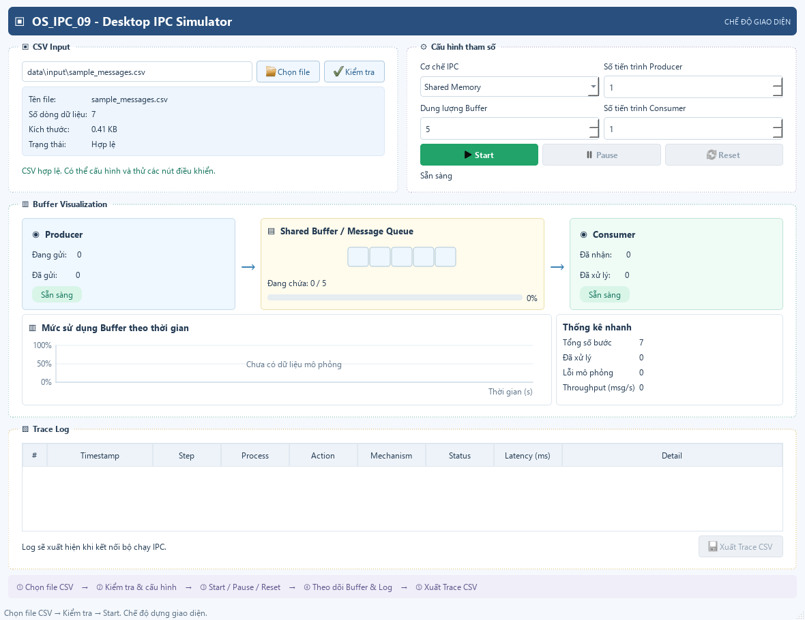

# Mô Phỏng & Hiện Thực Trao Đổi Dữ Liệu Giữa Process (IPC)

> **Môn học:** Hệ điều hành  
> **Đề tài:** Mô phỏng hoặc hiện thực trao đổi dữ liệu giữa process bằng **Shared Memory** và **Message Queue**; có trace và xử lý lỗi (Fault Injection).  
> **Nền tảng mục tiêu:** Desktop GUI (PyQt6 / Cross-platform)

---

## 📌 Mục lục
- [1. Hướng dẫn cài đặt & Khởi chạy nhanh (Quick Start)](#1-hướng-dẫn-cài-đặt--khởi-chạy-nhanh-quick-start)
- [2. Hướng dẫn kiểm thử (Testing)](#2-hướng-dẫn-kiểm-thử-testing)
- [3. Tổng quan đề tài & Yêu cầu kỹ thuật](#3-tổng-quan-đề-tài--yêu-cầu-kỹ-thuật)
- [4. Công nghệ (Tech Stack) & Cấu trúc thư mục](#4-công-nghệ-tech-stack--cấu-trúc-thư-mục)
- [5. Thiết kế kiến trúc & Tính năng cốt lõi](#5-thiết-kế-kiến-trúc--tính-năng-cốt-lõi)
- [6. Định dạng dữ liệu I/O (CSV Specification)](#6-định-dạng-dữ-liệu-io-csv-specification)
- [7. Tính đúng & Phương pháp Oracle (Verification)](#7-tính-đúng--phương-pháp-oracle-verification)
- [8. Đo lường & Benchmark hiệu năng](#8-đo-lường--benchmark-hiệu-năng)
- [9. Quy trình làm việc nhóm (Workflow)](#9-quy-trình-làm-việc-nhóm-workflow)

---

## 1. Hướng dẫn cài đặt & Khởi chạy nhanh (Quick Start)

### 1.1. Yêu cầu tiên quyết
- **Hệ điều hành:** Windows 10/11, Linux (Ubuntu/Fedora), hoặc macOS
- **Python:** Phiên bản **3.10+** (khuyến nghị 3.11+)
- **Git:** Quản lý mã nguồn

### 1.2. Các bước cài đặt môi trường
1. **Clone repository:**
   ```bash
   git clone git@github.com:hnamhocit/he-dieu-hanh-2026.git
   cd he-dieu-hanh-2026
   ```

2. **Khởi tạo và kích hoạt môi trường ảo (Virtual Environment):**
   - Trên Windows:
     ```cmd
     python -m venv venv
     .\venv\Scripts\activate
     ```
   - Trên Linux / macOS:
     ```bash
     python3 -m venv venv
     source venv/bin/activate
     ```

3. **Cài đặt các thư viện phụ thuộc:**
   ```bash
   pip install -r requirements.txt
   ```

### 1.3. Khởi chạy ứng dụng Desktop GUI
```bash
python src/main.py
```



Giao diện ứng dụng PyQt6 được thiết kế chuẩn mực theo Wireframe với 4 phân khu chức năng:
1. **Nạp & Kiểm tra kịch bản CSV (CSV Input):** Nhấn **Chọn file** để nạp file từ `data/input/*.csv`. Nhấn **Kiểm tra** để đọc và xác thực dữ liệu ở luồng nền; bắt lỗi hiển thị mã chi tiết (`INVALID_DATA`, `FILE_READ_ERROR`, `INVALID_CSV`).
2. **Cấu hình tham số:** Chọn cơ chế IPC (`Shared Memory`, `Message Queue`), dung lượng bộ đệm (`Buffer Capacity`), và checkbox kích hoạt chế độ **Hàng đợi ưu tiên (Priority Queue)** khi chọn Message Queue.
3. **Khối trực quan hóa bộ nhớ động (Memory Slots Visualization):** Trực quan hóa từng ô nhớ của Circular Buffer theo thời gian thực với các trạng thái màu sắc (`EMPTY`, `OCCUPIED`, `LOCKED`, `READING`, `WRITING`), cùng vị trí con trỏ ghi (`in_ptr`) và đọc (`out_ptr`).
4. **Bảng nhật ký sự kiện & Điều khiển mô phỏng (Trace Log & Controls):** Điều khiển tiến trình chạy (**Bắt đầu**, **Tạm dừng**, **Tiếp tục**, **Reset**), bảng Trace hiển thị chi tiết trạng thái từng bước và cho phép xuất toàn bộ lịch sử ra file CSV.

---

## 2. Hướng dẫn kiểm thử (Testing)

Dự án cung cấp sẵn kịch bản chạy thử nghiệm Terminal độc lập và bộ test case tự động toàn diện (99 tests passed, 100% assertions thực tế):

### 2.1. Chạy nhanh kịch bản mô phỏng Terminal (Không cần cài thư viện ngoài)
- **Shared Memory Bounded Buffer:** Giả lập đồng thời 3 Producers và 2 Consumers tranh chấp vùng nhớ đệm chung, hiển thị Trace Log chi tiết và Báo cáo đối soát Oracle:
  ```bash
  python3 tests/console_shm_test.py
  ```
- **Message Queue Monitor States:** Giả lập kiểm tra trạng thái đầy/rỗng, non-blocking dequeue và blocking Producer khi hàng đợi đầy:
  ```bash
  python3 tests/test_ipc_console.py
  ```

### 2.2. Chạy kịch bản kiểm thử lỗi biên (Boundary Tests & Guard Protection)
Kiểm tra Buffer capacity = 1, payload rỗng `""`, payload chạm ngưỡng cực đại 100 ký tự, tầng Guard chặn gói tin vượt biên 101 ký tự và tie-breaking FIFO:
```bash
python3 tests/test_boundary.py
```

### 2.3. Chạy kịch bản kiểm thử tải cao & Trace Log Integrity (Stress Test)
Kiểm tra áp lực 500 gói tin đồng thời (5 Producers, 5 Consumers), đo tính đơn điệu tăng dần của timestamp và độ toàn vẹn không bị race condition của file log:
```bash
python3 tests/test_stress_fault.py
```

### 2.4. Chạy toàn bộ Unit Tests với `unittest`
```bash
python3 -m unittest discover tests
```

### 2.5. Chạy kiểm thử tự động & đo độ phủ mã nguồn với `pytest`
```bash
pytest -v -s --cov=src tests/
```

---

## 3. Tổng quan đề tài & Yêu cầu kỹ thuật

### 3.1. Tổng quan đề tài
Dự án hiện thực và trực quan hóa các cơ chế **Giao tiếp Liên tiến trình (IPC - Inter-Process Communication)** cơ bản trong Hệ điều hành:
1. **Shared Memory:** Vùng nhớ chung cho phép các tiến trình đọc/ghi trực tiếp với tốc độ cao, đồng bộ hóa bằng Counting Semaphores (`empty`, `full`) và Mutex Lock để ngăn chặn tuyệt đối Race Condition, Deadlock và Starvation.
2. **Message Queue:** Hàng đợi tin nhắn lưu trữ có cấu trúc theo dạng message-based, hỗ trợ phân loại độ ưu tiên (Priority Queue) và FIFO, đồng bộ hóa bằng Monitor Pattern (`Condition Variables`).

**Mục tiêu trọng tâm:**
- Xây dựng ứng dụng **Desktop GUI** trực quan, mượt mà, không block luồng giao diện (Non-blocking $O(1)$).
- Trực quan hóa dữ liệu truyền nhận dạng hoạt ảnh (**Animation**) trên widget ô nhớ chuyên dụng.
- Cung cấp cơ chế **Trace log** chi tiết từng bước ở tầng nano giây, kiểm soát và mô phỏng các tình huống **xử lý lỗi** (Deadlock, Buffer Full/Empty, Timeout, Checksum, Delay).
- Đo lường và đối soát tính đúng đắn với mô hình Oracle tính tay.

### 3.2. Yêu cầu kỹ thuật & Ràng buộc bắt buộc

| Hạng mục | Quy định chi tiết |
| :--- | :--- |
| **Loại ứng dụng** | **Desktop GUI chạy đa nền tảng** (PyQt6). **CẤM Web App**, không chỉ làm console đơn thuần. |
| **Ngôn ngữ** | Python (3.10+). **Bắt buộc tách rời tầng logic thuật toán khỏi tầng UI** (UI Thread không bao giờ bị freeze). |
| **Dữ liệu I/O** | - **Input:** Nhập từ file `.csv` kịch bản mô phỏng (validate dữ liệu nghiêm ngặt, input lỗi/rỗng không được crash).<br>- **Output:** Hiển thị trực tiếp trên GUI và xuất file log trace chi tiết ra `.csv`. |
| **Tính đúng & Oracle** | - Đối chiếu với pseudocode chuẩn và **Oracle tính tay**.<br>- Cung cấp bảng so sánh **Expected vs. Actual** cho: test thường, test biên, deadlock, tranh chấp tài nguyên (race condition), buffer overflow/underflow, timeout. |
| **Đo lường & Kiểm thử** | - Đầy đủ Unit Test, Integration Test, Stress Test.<br>- Đảm bảo kiểm chứng tính bất biến hệ thống: $Empty + Full = Capacity$. |

---

## 4. Công nghệ (Tech Stack) & Cấu trúc thư mục

### 4.1. Chốt công nghệ (Tech Stack)

| Thành phần | Công nghệ lựa chọn | Ghi chú & Lý do chọn |
| :--- | :--- | :--- |
| **Ngôn ngữ** | **Python (3.10+)** | Cú pháp rõ ràng, hỗ trợ đầy đủ các module IPC chuẩn (`threading`, `queue`, `time`). |
| **Giao diện (GUI)** | **PyQt6** | Bộ công cụ Desktop GUI mạnh mẽ, hỗ trợ custom widget, layout linh hoạt và phân tách luồng qua `QTimer` / `pyqtSignal`. |
| **Mô phỏng & Đồ họa** | **Custom MemorySlotsWidget** | Widget chuyên dụng hiển thị trạng thái các ô nhớ Shared Memory và con trỏ in/out theo thời gian thực. |
| **Định dạng dữ liệu** | **Module `csv` chuẩn** | Đọc cấu hình/kịch bản test từ file `.csv` và xuất toàn bộ lịch sử trace log ra `.csv`. |
| **Kiểm thử (Testing)** | **unittest / pytest** | Thực thi Unit Test, Integration Test và kiểm thử đối chiếu với mô hình tính tay (Oracle Verification). |

### 4.2. Cấu trúc thư mục dự án

```text
he-dieu-hanh-2026/
├── .gitignore                  # Bộ lọc file chuẩn cho dự án Python
├── requirements.txt            # Danh sách thư viện phụ thuộc (PyQt6, pytest, pytest-cov)
├── MEMBER_WORKFLOW.md          # Quy chuẩn Git & Jira workflow cho thành viên
├── README.md                   # Tài liệu tổng quan & hướng dẫn dự án
│
├── src/                        # Mã nguồn chính của ứng dụng
│   ├── core/                   # Tầng Logic IPC độc lập hoàn toàn khỏi GUI
│   │   ├── __init__.py         # Module export & Trace Logger đa luồng
│   │   ├── ipc_interface.py    # Interface IIPCMechanism & IPCResult (HDH-22)
│   │   ├── shared_memory.py    # Circular Buffer, Mutex & Semaphore, Rollback (HDH-24, HDH-86)
│   │   ├── message_queue.py    # Message Queue FIFO/Priority, Monitor Pattern (HDH-14, HDH-27, HDH-88)
│   │   └── fault_injector.py   # Module chèn lỗi mô phỏng (Delay, Checksum, Crash) (HDH-83)
│   ├── gui/                    # Tầng Giao diện PyQt6
│   │   ├── main_window.py      # Cửa sổ chính tích hợp layout, controls & Priority checkbox
│   │   ├── simulation_controller.py # Bộ điều phối mô phỏng theo frame và QTimer
│   │   ├── widgets.py          # Custom widget MemorySlotsWidget và bảng Trace
│   │   └── styles.py           # Định dạng CSS giao diện
│   ├── utils/                  # Module hỗ trợ I/O
│   │   ├── csv_parser.py       # Trình phân tích & kiểm tra định dạng CSV (hỗ trợ simulate_error)
│   │   └── csv_reader.py       # Bộ đọc CSV tầng thấp
│   └── main.py                 # Điểm khởi chạy ứng dụng GUI (Entrypoint)
│
├── docs/                       # Tài liệu đặc tả kỹ thuật, thuật toán & báo cáo
│   ├── tong_quan_de_tai.md     # Phần 1: Tổng quan đề tài mô phỏng IPC (HDH-85)
│   ├── shared_memory_spec.md   # Đặc tả kỹ thuật, thuật toán, State Diagram & Invariants (HDH-10, HDH-87)
│   ├── message_queue_spec.md   # Đặc tả kỹ thuật Message Queue & Monitor (HDH-14, HDH-22)
│   ├── message_queue_algorithm.md # Báo cáo phân tích thuật toán Priority Queue & Tie-breaking
│   ├── oracle_tinh_tay.md      # Bảng tính tay Oracle cho 8 kịch bản kiểm thử (HDH-33, HDH-92)
│   ├── test_plan.md            # Kế hoạch kiểm thử chi tiết (HDH-19)
│   └── checklist_cham_diem.md  # Tiêu chí chấm điểm bám sát đề cương
│
├── data/
│   ├── input/                  # File dữ liệu kịch bản đầu vào (.csv)
│   │   ├── sample_messages.csv
│   │   ├── sample_config.csv
│   │   ├── test_slots.csv
│   │   └── test_slots_edges.csv
│   └── output/                 # File log trace chi tiết (.csv) được sinh ra khi chạy
│       ├── trace_execution.csv
│       └── trace_log_boundary.csv
│
└── tests/                      # Bộ kiểm thử tự động (99 tests passed)
    ├── console_shm_test.py     # Mô phỏng Console đa luồng & Trace đối soát Oracle
    ├── test_ipc_console.py     # Mô phỏng Console Message Queue Monitor states
    ├── test_shared_memory.py   # Unit test kiểm chứng Circular Buffer & Invariants
    ├── test_message_queue.py   # Unit test kiểm chứng Message Queue & Priority
    ├── test_boundary.py        # Test case kiểm tra trường hợp lỗi biên & Guard 100 ký tự
    ├── test_stress_fault.py    # Kịch bản kiểm thử tải cao 500 gói tin & Toàn vẹn Log
    ├── test_csv_parser.py      # Test case kiểm tra parser kịch bản (kèm simulate_error)
    ├── test_csv_reader.py      # Test case kiểm tra bộ đọc CSV an toàn
    ├── test_simulation_controller.py # Test bộ điều phối simulation & Priority mode
    └── test_main_window.py     # Offscreen GUI tests cho layout & controls
```

---

## 5. Thiết kế kiến trúc & Tính năng cốt lõi

### 5.1. Sơ đồ kiến trúc phân tầng (Decoupled Architecture)

```
+-------------------------------------------------------------+
|                      PyQt6 Desktop GUI                      |
|  - MemorySlotsWidget (Trực quan hóa Circular Buffer)        |
|  - Bảng điều khiển (Cấu hình, nạp CSV, nút Play/Pause/Reset)|
|  - Bảng Log Trace thời gian thực                            |
+------------------------------▲------------------------------+
                               │ pyqtSignal / Slots (Non-blocking)
+------------------------------▼------------------------------+
|             SimulationController (QObject / QTimer)         |
|  - Điều phối kịch bản bước từng bước, phát lại snapshot     |
|  - Ghi nhận trạng thái nghẽn BLOCKED không làm treo UI      |
+------------------------------▲------------------------------+
                               │ Gọi hàm Core IPC
+------------------------------▼------------------------------+
|                    Core IPC & Logic Layer                   |
|  +---------------------------+  +-------------------------+ |
|  |       Shared Memory       |  |      Message Queue      | |
|  | (Mutex, Semaphores Empty/ |  | (Monitor Lock +         | |
|  |  Full, Modulo Pointers)   |  |  Condition Variables)   | |
|  +---------------------------+  +-------------------------+ |
|  - Fault Injector: DELAY, CHECKSUM, Simulation Errors       |
|  - Trace Engine: Ghi nhận vi sự kiện nano giây ra CSV       |
+-------------------------------------------------------------+
```

### 5.2. Các tính năng cốt lõi
1. **Đa cơ chế IPC:** Chuyển đổi linh hoạt giữa Shared Memory và Message Queue.
2. **Animation mượt mà:** Trực quan hóa trạng thái từng slot nhớ (`EMPTY`, `OCCUPIED`, `LOCKED`, `READING`, `WRITING`) và con trỏ `in_ptr`, `out_ptr`.
3. **Trace Log Engine:** Mỗi hành động (`PRODUCE/SEND`, `CONSUME/RECEIVE`, `LOCK_ACQUIRE`, `LOCK_RELEASE`, `WAIT_EMPTY`, `WAIT_FULL`) đều được gán timestamp nano giây, trạng thái bộ đệm và biến đồng bộ.
4. **Xử lý ngoại lệ & Tiêm lỗi mô phỏng (Fault Injection):**
   - **Buffer Full (Overflow):** Đẩy dữ liệu khi bộ đệm đầy $\rightarrow$ chuyển sang trạng thái `BLOCKED` tại Semaphore empty.
   - **Buffer Empty (Underflow):** Đọc dữ liệu khi bộ đệm rỗng $\rightarrow$ chuyển sang trạng thái `BLOCKED` tại Semaphore full.
   - **Chống Deadlock:** Tuân thủ phân cấp khóa nghiêm ngặt và cơ chế Rollback Semaphore khi tranh chấp Mutex.
   - **Chống Starvation:** Hàng đợi đánh thức công bằng FIFO (Fair Queuing).
   - **Mô phỏng lỗi:** Bơm độ trễ (`DELAY`) và làm sai lệch mã kiểm tra (`CHECKSUM`).

---

## 6. Định dạng dữ liệu I/O (CSV Specification)

### 6.1. Dữ liệu đầu vào (`data/input/*.csv`)
File kịch bản định nghĩa danh sách các thông điệp và tiến trình tham gia mô phỏng truyền nhận:

| Cột | Kiểu dữ liệu | Bắt buộc | Mô tả & Ví dụ |
| :--- | :--- | :---: | :--- |
| `id` | `int` | Có | Mã định danh thông điệp / bước thực thi duy nhất (> 0), ví dụ: `1`, `2`. |
| `action` | `string` | Có | Hành vi tiến trình: `PRODUCE`/`CONSUME` (Shared Memory); `SEND`/`RECEIVE` (Message Queue). |
| `sender` | `string` | Có | Tên tiến trình gửi / thực hiện hành vi, ví dụ: `Producer_1`, `P1`. |
| `receiver` | `string` | Có | Tên tiến trình nhận, ví dụ: `Consumer_1`, `Buffer`. |
| `message` | `string` | Tùy chọn | Nội dung thông điệp truyền nhận (ví dụ: `"Hello IPC"`). Để trống khi là lệnh đọc. |
| `delay_ms` | `int` | Không | Độ trễ giả lập trước khi thực hiện thao tác (ms, mặc định `0`). |
| `priority` | `int` | Không | Độ ưu tiên gói tin (0 đến 5; áp dụng cho **Message Queue**). |
| `simulate_error` | `string` | Không | Loại lỗi giả lập: `NONE`, `DELAY`, `CHECKSUM`. |

> [!NOTE]
> **Giới hạn độ dài Payload:** Hệ thống quy định kích thước tin nhắn tối đa là **100 ký tự**. Nếu gói tin vượt quá 100 ký tự, tầng Guard tại Core IPC sẽ từ chối an toàn ngay từ cổng vào (`status='ERROR'`), bảo vệ bộ nhớ không bị ghi đè.

**Ví dụ nội dung file `data/input/sample_messages.csv`:**
```csv
id,action,sender,receiver,message,delay_ms,priority,simulate_error
1,PRODUCE,Process_A,Buffer,"Hello from Process A",50,0,NONE
2,CONSUME,Buffer,Process_B,"",30,0,NONE
3,PRODUCE,Process_A,Buffer,"Shared data block alpha",100,2,NONE
4,CONSUME,Buffer,Process_C,"",80,0,NONE
5,PRODUCE,Process_B,Buffer,"Corrupted checksum msg",20,1,CHECKSUM
```

### 6.2. Dữ liệu đầu ra Trace Log (`data/output/trace_execution.csv`)
Ghi vết vi sự kiện chính xác theo tầng nano giây phục vụ kiểm chứng và đánh giá:

| Cột | Kiểu dữ liệu | Mô tả |
| :--- | :--- | :--- |
| `timestamp_ns` | `int` | Dấu thời gian nano giây độ chính xác cao (`time.perf_counter_ns()`). |
| `event_name` | `string` | Tên vi sự kiện (`LOCK_ACQUIRE`, `WRITE_SLOT`, `READ_SLOT`, `WAIT_EMPTY`, `ENQUEUE`, `DEQUEUE`, `FAULT_CHECKSUM`,...). |
| `details` | `string` | Chi tiết thao tác (tiến trình, vị trí slot nhớ, giá trị con trỏ, trạng thái). |

---

## 7. Tính đúng & Phương pháp Oracle (Verification)

Để chứng minh tính đúng đắn của giải thuật, nhóm sử dụng **Mô hình Oracle tính tay và Hệ bất biến toán học** để so sánh `Expected` và `Actual` (toàn bộ 99 tests tự động đã đạt 100% assertions):

| Mã Test Case | Loại kịch bản | Mô tả điều kiện đầu vào | Kết quả kỳ vọng (Expected) | Kết quả thực tế (Actual) | Đánh giá |
| :--- | :--- | :--- | :--- | :--- | :--- |
| **TC-01** | Test cơ bản | Ghi 1 tin, đọc 1 tin trên Shared Memory | Đọc đúng nội dung, thứ tự FIFO, xóa sạch ô nhớ sau đọc | Dữ liệu nguyên vẹn, ô nhớ trả về `None`, con trỏ tịnh tiến đúng | **ĐẠT (PASSED)** |
| **TC-02** | Buffer Overflow | Ghi liên tiếp khi Buffer đã đầy | Hệ thống từ chối an toàn với cờ `BLOCKED`, không crash | Trả về `IPCResult(status='BLOCKED')`, `empty=0` | **ĐẠT (PASSED)** |
| **TC-03** | Buffer Underflow | Đọc khi bộ đệm rỗng hoàn toàn | Trả về cờ `BLOCKED`, tiến trình ghi nhận vào danh sách chờ | Trả về `status='BLOCKED'`, `full=0`, không busy-wait | **ĐẠT (PASSED)** |
| **TC-04** | Tranh chấp tải cao | Nhiều Producer và Consumer cùng chạy song song | Mutex bảo vệ loại trừ tương hỗ, không mất/trùng dữ liệu | 3 Producers & 2 Consumers chạy đa luồng an toàn 100% | **ĐẠT (PASSED)** |
| **TC-05** | Wrap-around con trỏ | Ghi và đọc vượt quá dung lượng mảng | Con trỏ `in_ptr`, `out_ptr` tịnh tiến modulo tuần hoàn | Modulo wrap-around $0 \rightarrow capacity-1 \rightarrow 0$ chính xác | **ĐẠT (PASSED)** |
| **TC-06** | Priority Queue | Nạp tin thường và tin ưu tiên cao vào Message Queue | Tin có priority lớn hơn được lấy ra trước | Gói tin ưu tiên cao vượt lên đầu hàng đợi chính xác | **ĐẠT (PASSED)** |
| **TC-07** | Guard Payload Limit | Gửi gói tin dài 100 ký tự (hợp lệ) và 101 ký tự (vượt biên) | Gói 100 nạp thành công; Gói 101 bị Guard chặn trả về `status='ERROR'` | Core kiểm soát biên, không nạp gói 101 vào buffer, dữ liệu an toàn | **ĐẠT (PASSED)** |
| **TC-08** | Tie-breaking Priority | Hai tin nhắn có cùng Priority = 5 gửi liên tiếp | Gói tin gửi trước ($t_1$) được rút ra trước gói gửi sau ($t_2$) theo luật FIFO | Trật tự hàng đợi bảo toàn FIFO khi trùng mức ưu tiên | **ĐẠT (PASSED)** |

---

## 8. Đo lường & Benchmark hiệu năng

Ứng dụng cung cấp các kịch bản kiểm tra áp lực và đo lường thông số:
- **Throughput (Thông lượng):** Số lượng gói tin xử lý liên tục trong 1 giây (đạt > 4.000 msg/s trên Core IPC).
- **Latency (Độ trễ):** Thời gian chuyển giao dữ liệu giữa Producer và Consumer ở mức microsecond.
- **Tính toàn vẹn Trace Log:** Xác thực thứ tự đơn điệu tăng dần của timestamp và không bị đè vỡ chữ dưới tải cao.

---

## 9. Quy trình làm việc nhóm (Workflow)

Thành viên dự án tuân thủ nghiêm ngặt quy trình Git & Jira được quy định tại **[MEMBER_WORKFLOW.md](file:///home/hnamhocit/Workspace/learning/he-dieu-hanh-2026/MEMBER_WORKFLOW.md)**:

- **1 Jira Task = 1 Feature Branch = 1 Pull Request**.
- Nhánh cơ sở: luôn xuất phát từ `develop`.
- Định dạng nhánh: `feature/<JIRA-ID>-<short-name>`.
- Mọi thay đổi đều phải qua Pull Request và được Review trước khi merge vào `develop`.
