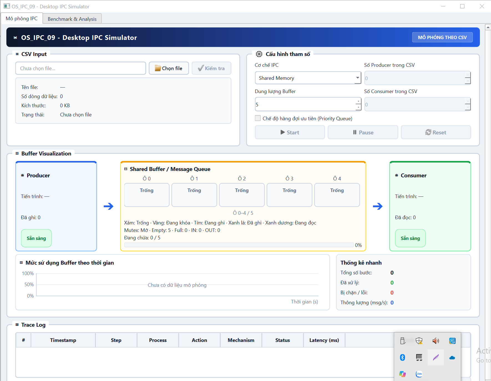
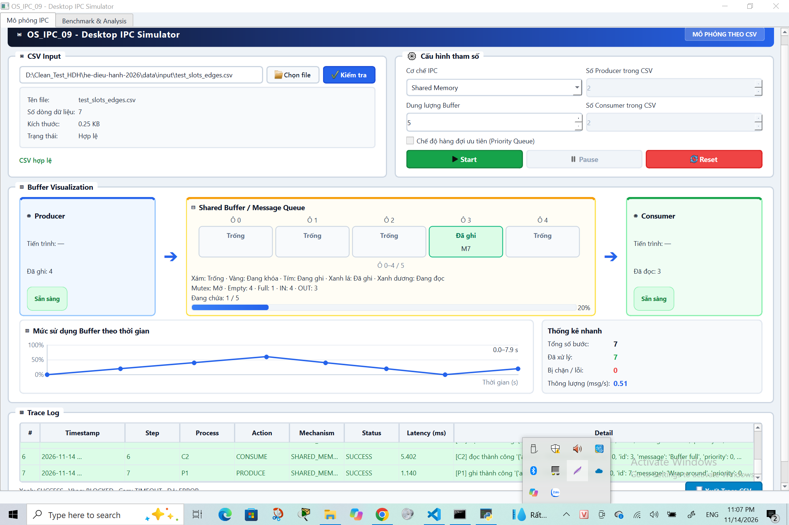
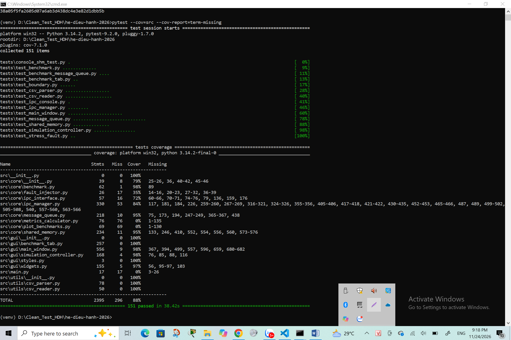
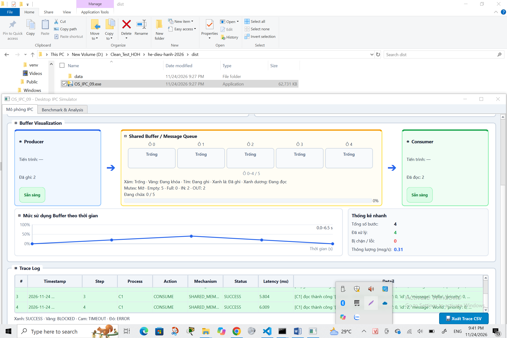

# Báo cáo Kiểm thử Repo sạch trên môi trường mới (Clean Repo Test)

## 1. Thông tin môi trường & Phiên bản kiểm thử (Test Environment)
* **Mã Commit kiểm thử (Commit SHA):** `38a05f5fa2605d07a6ab3d438dc4e3e82d1dbb5b`
* **Đường dẫn triển khai:** `D:\Clean_Test_HDH\he-dieu-hanh-2026`
* **Hệ điều hành & Nền tảng:** Windows (win32)
* **Môi trường ảo & Phiên bản ngôn ngữ:** Virtual Environment (`venv`) độc lập chạy Python 3.14.2 (final-0)
* **Quy trình thực hiện:** Clone mã nguồn mới hoàn toàn → checkout đúng commit trên → khởi tạo `venv` mới → cài đặt các gói phụ thuộc và khởi chạy ứng dụng theo đúng hướng dẫn tại `README.md`.

## 2. Kết quả kiểm thử tự động (Automated Test & Code Coverage)
* **Lệnh thực thi kiểm thử (Reproducible Command):**
  ```bash
  pytest --cov=src --cov-report=term-missing
  ```
* **Trạng thái thực thi (ảnh thứ ba):** 151/151 test cases passed trong tổng thời gian 38.42 giây (không phát sinh lỗi thiếu thư viện hay xung đột gói).
* **Độ bao phủ mã nguồn (Code Coverage):** Đạt **88%** trên tổng số 2.395 dòng lệnh (Statements). Trong đó, các module cốt lõi đều đạt tỷ lệ bao phủ rất cao:
  * `src/gui/benchmark_tab.py`, `src/utils/csv_parser.py`, `src/utils/csv_reader.py`: 100%
  * `src/gui/main_window.py`, `src/gui/simulation_controller.py`, `src/core/benchmark.py`: 98%
  * `src/core/message_queue.py`, `src/core/shared_memory.py`: 95%

## 3. Kết quả kiểm thử giao diện từ mã nguồn (UI & Functional Test - Source)
* **Khởi tạo giao diện ban đầu (ảnh thứ nhất):** Ứng dụng `OS_IPC_09 - Desktop IPC Simulator` khởi động thành công từ mã nguồn, hiển thị đầy đủ các phân khu chức năng (CSV Input, Cấu hình tham số, Buffer Visualization, Mức sử dụng Buffer theo thời gian, Thống kê nhanh và Trace Log) ở trạng thái sẵn sàng.
* **Kiểm thử luồng mô phỏng với dữ liệu thực (ảnh thứ hai):**
  * **Dữ liệu đầu vào:** Nạp thành công file `test_slots_edges.csv` (0.25 KB, 7 dòng dữ liệu) với trạng thái xác thực "Hợp lệ".
  * **Cấu hình chạy:** Cơ chế Shared Memory, dung lượng Buffer 5 ô, tự động nhận diện 2 Producer và 2 Consumer từ file CSV.
  * **Kết quả vận hành:** Hoàn thành 7/7 bước xử lý (0 lỗi/bị chặn), thông lượng đạt 0.51 msg/s, độ trễ (Latency) được ghi nhận chính xác trên từng bước trong Trace Log (1.140 ms cho tác vụ PRODUCE, 5.402 ms cho tác vụ CONSUME), biểu đồ sử dụng Buffer và trạng thái các ô nhớ cập nhật trực quan, mượt mà.







## 4. Kết quả kiểm thử bản đóng gói thực thi (Standalone `.exe` Test)
* **Tệp thực thi kiểm thử:** `dist/OS_IPC_09.exe` (đóng gói bằng PyInstaller `--onefile --windowed`).
* **Kết quả vận hành (ảnh thứ tư):** Khởi chạy trực tiếp tệp thực thi `.exe` độc lập trên Windows. Ứng dụng mở giao diện đầy đủ, nạp dữ liệu CSV và hoàn tất toàn bộ các bước mô phỏng mượt mà, không phát sinh lỗi thiếu thư viện động (DLL) hay tài nguyên giao diện.


