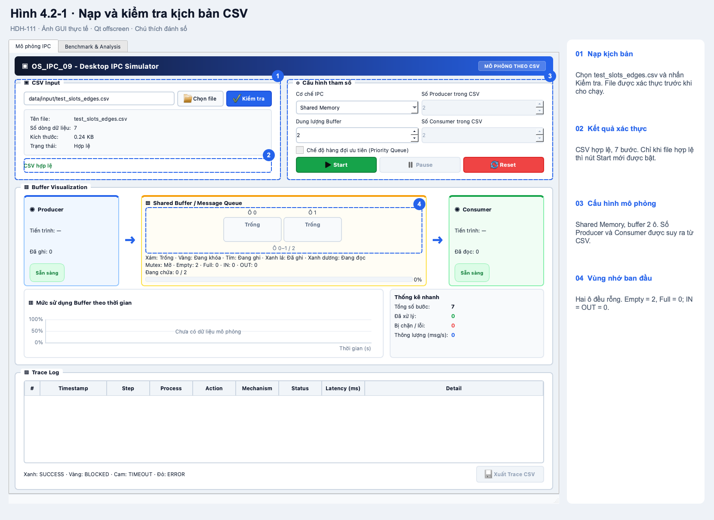
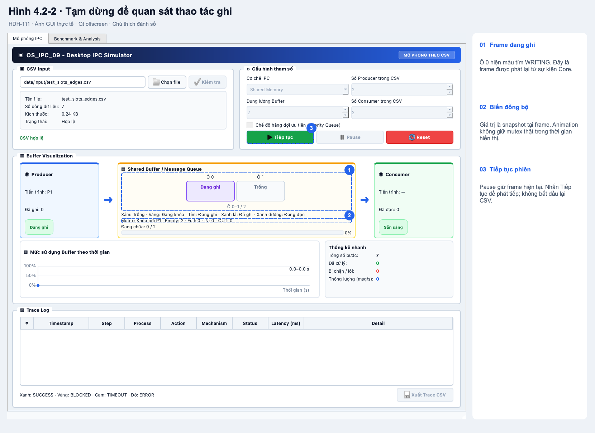
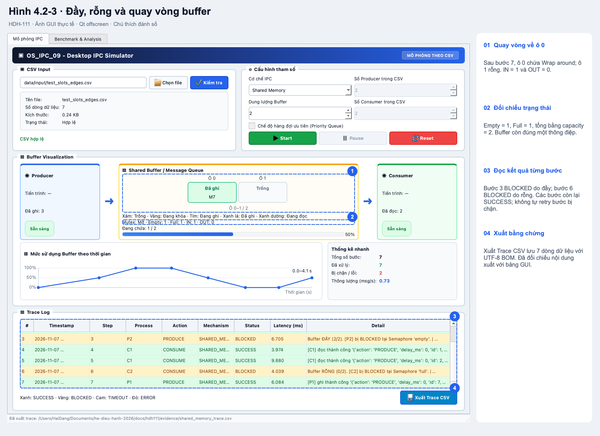
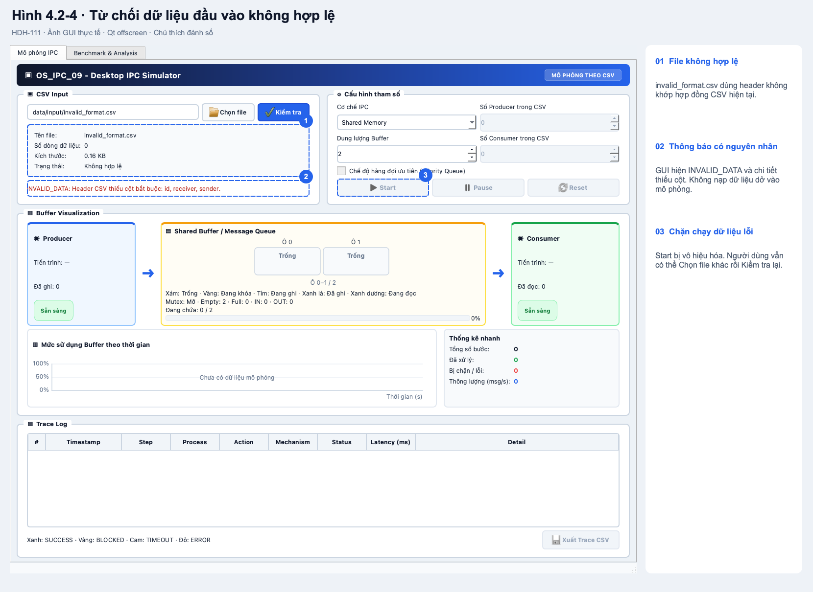
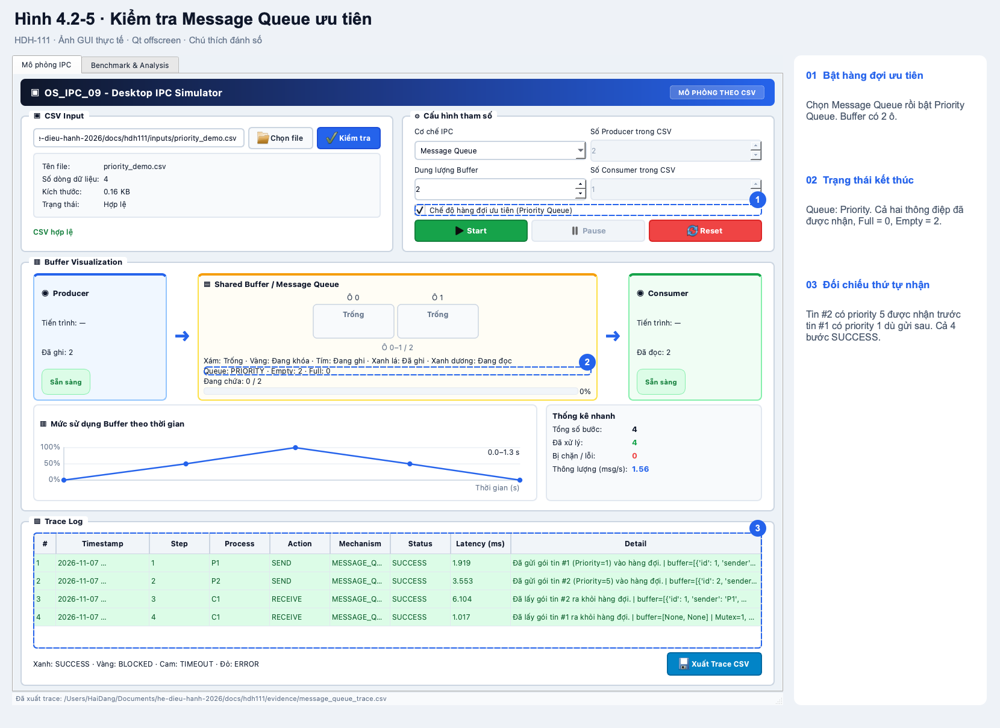
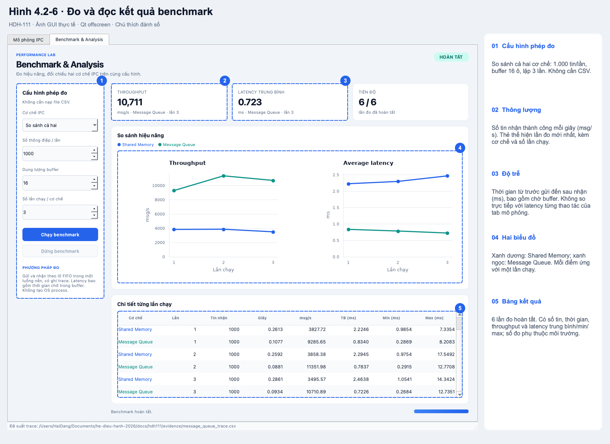

# Mục 4 — Kiểm thử giao diện và hướng dẫn tương tác


Tài liệu cung cấp phần kiểm thử GUI, hướng dẫn sử dụng hệ thống trực quan hóa và ảnh có chú thích để ghép vào báo cáo. Các tiểu mục 4.2 và 4.3 được đề xuất để nối sau phần 4.1 kiểm chứng sai khác; có thể đổi số khi nhóm ghép báo cáo chính thức.

**Phiên bản được kiểm tra:** commit `b1ae0e6a292005fec82e82d18bb80c6411dadda1` của HDH-110, [PR #53](https://github.com/hnamhocit/he-dieu-hanh-2026/pull/53). Tại thời điểm soạn tài liệu, `develop` ở `51af241` chưa tích hợp tab benchmark. Vì vậy, cần dùng phiên bản có HDH-110 để tái hiện đầy đủ ảnh và hướng dẫn dưới đây. Nhánh HDH-111 chỉ bổ sung tài liệu, kịch bản minh họa và bằng chứng; không thay đổi mã nguồn ứng dụng.

## 4.2 Kiểm thử giao diện và hệ thống trực quan hóa

### 4.2.1 Mục tiêu, môi trường và phương pháp

Kiểm thử tập trung vào hành trình người dùng: chọn CSV, xác thực, cấu hình cơ chế IPC, điều khiển phiên chạy, quan sát buffer, đọc và xuất trace, sau đó chạy benchmark. Một thao tác chỉ được coi là đúng khi trạng thái điều khiển, hình vẽ và dữ liệu kết quả thống nhất với nhau. Chẳng hạn, khi một lần ghi bị `BLOCKED` do đầy, GUI phải báo đúng kết quả và không làm mất dữ liệu đã có trong buffer.

Ảnh được chụp trực tiếp từ widget PyQt6 đang chạy bằng `window.grab()`. Đường viền và số thứ tự là lớp chú thích bổ sung; số liệu, nhãn, bảng và đồ thị bên trong ảnh lấy từ ứng dụng. Các ca minh họa gọi Core thật, không thay kết quả Core bằng dữ liệu giả.

Môi trường kiểm tra là macOS/arm64, Python và các thư viện theo [manifest môi trường](hdh111/evidence/observations.json). Giao diện dùng Qt Fusion, kích thước cửa sổ 1280 × 1080, chạy với `QT_QPA_PLATFORM=offscreen`. Bộ chụp dùng QTest bấm các nút; đường dẫn CSV và nơi lưu được truyền vào điểm nhận kết quả của hộp thoại. Do đó, bằng chứng này kiểm tra logic GUI và kết xuất widget, chưa xác nhận hộp thoại chọn/lưu file native, thao tác chuột trên desktop thật hay hiển thị trên Windows/Linux.

### 4.2.2 Dữ liệu và kết quả đối chiếu trực tiếp trên GUI

**Kịch bản Shared Memory:** [test_slots_edges.csv](../data/input/test_slots_edges.csv), dung lượng 2. Thứ tự các bước được giữ theo CSV. Số Producer/Consumer được xác định từ `sender` của các dòng gửi/nhận, không phải số OS process được tạo.

| Bước | Thao tác | Kết quả kỳ vọng | Kết quả thực tế | Buffer sau bước (ô 0, ô 1) | IN / OUT | Empty / Full |
| --- | --- | --- | --- | --- | --- | --- |
| 1 | P1 ghi `Hello` | Ghi thành công | SUCCESS | Hello, trống | 1 / 0 | 1 / 1 |
| 2 | P1 ghi `World` | Ghi thành công, buffer đầy | SUCCESS | Hello, World | 0 / 0 | 0 / 2 |
| 3 | P2 ghi `Buffer full` | Không ghi đè dữ liệu cũ | BLOCKED | Hello, World | 0 / 0 | 0 / 2 |
| 4 | C1 đọc | Nhận `Hello` trước | SUCCESS | trống, World | 0 / 1 | 1 / 1 |
| 5 | C1 đọc | Nhận `World`, buffer rỗng | SUCCESS | trống, trống | 0 / 0 | 2 / 0 |
| 6 | C2 đọc | Không lấy được dữ liệu khi rỗng | BLOCKED | trống, trống | 0 / 0 | 2 / 0 |
| 7 | P1 ghi `Wrap around` | Tái sử dụng ô 0 | SUCCESS | Wrap around, trống | 1 / 0 | 1 / 1 |

Tại các trạng thái cuối bước, `Empty + Full = Capacity = 2`. Trace có 7 dòng dữ liệu, gồm 5 `SUCCESS` và 2 `BLOCKED`; xuất CSV giữ nguyên nội dung bảng. Dữ liệu đối chiếu nằm trong [shared_memory_trace.csv](hdh111/evidence/shared_memory_trace.csv). Các bước `BLOCKED` được ghi nhận rồi chuyển sang bước kế tiếp; bộ chạy GUI hiện không tự động thử lại khi sau đó có dữ liệu hoặc chỗ trống.

**Kịch bản Message Queue ưu tiên:** [priority_demo.csv](hdh111/inputs/priority_demo.csv), dung lượng 2, bật Priority Queue. Tin #1 có priority 1 được gửi trước tin #2 có priority 5. Kỳ vọng nhận #2 rồi #1; kết quả thực tế đúng thứ tự `[2, 1]`, cả 4 bước `SUCCESS` và buffer rỗng sau khi nhận xong. Xem [message_queue_trace.csv](hdh111/evidence/message_queue_trace.csv) và trường `priority_queue` trong manifest.

### 4.2.3 Ma trận kiểm thử giao diện

“Đạt” trong bảng chỉ áp dụng cho môi trường và phiên bản nêu trên. Cột bằng chứng phân biệt tình huống được thực hiện trong bộ chụp với ca hồi quy tự động; không dùng ảnh minh họa để suy ra những thao tác chưa được kiểm tra.

| Mã | Đầu vào và thao tác | Kết quả mong đợi | Kết quả thực tế | Bằng chứng | Đánh giá |
| --- | --- | --- | --- | --- | --- |
| GUI-01 | Mở ứng dụng, chưa chọn CSV | Start tắt; không chạy dữ liệu rỗng | Trạng thái EMPTY, Start tắt | Manifest `initial`; test `test_start_requires_successful_validation` | Đạt |
| GUI-02 | Chọn `test_slots_edges.csv`, nhấn Kiểm tra | Hiện file hợp lệ, 7 bước; bật Start | Đúng 7 bước, READY, Start bật | Hình 4.2-1; manifest `valid_csv` | Đạt |
| GUI-03 | Kiểm tra `invalid_format.csv` | Báo lỗi header; Start tắt; không giữ dữ liệu cũ | INVALID_DATA; danh sách bước rỗng; Start tắt | Hình 4.2-4; manifest `invalid_csv` | Đạt |
| GUI-04 | Nạp file rỗng, sai cú pháp, sai encoding hoặc đã bị xóa | Báo INVALID_DATA, INVALID_CSV hoặc FILE_READ_ERROR tương ứng; cho kiểm tra lại | Các assertion lỗi và nạp lại file hợp lệ đều qua | Tests `test_error_then_valid_file`, `test_malformed_csv_and_invalid_encoding_are_reported`, `test_removed_file_does_not_leave_old_data_ready` | Đạt qua test tự động |
| GUI-05 | Shared Memory, capacity 2; Start kịch bản 7 bước | Hình vẽ, con trỏ và trạng thái đầy/rỗng khớp bảng đối chiếu | 5 SUCCESS, 2 BLOCKED; cuối cùng count=1, IN=1, OUT=0 | Hình 4.2-3; trace Shared Memory; test `test_full_empty_and_wraparound_match_oracle` | Đạt |
| GUI-06 | Pause tại frame WRITING; nhấn Tiếp tục | Giữ frame khi Pause; tiếp tục phiên hiện tại | PAUSED, ô 0 WRITING, nút đổi thành Tiếp tục; sau đó đủ 7 bước | Hình 4.2-2; manifest `pause` | Đạt |
| GUI-07 | Reset sau chạy; Reset khi worker còn xử lý | Xóa log/trạng thái tạm; giữ CSV hợp lệ; bỏ kết quả cũ về muộn | Trace về 0, giữ 7 bước CSV, READY; test loại kết quả worker cũ qua | Manifest `reset`; tests `test_reset_discards_in_flight_result_after_restart`, `test_reset_while_locked_clears_transient_display_and_timer` | Đạt |
| GUI-08 | Chuyển cơ chế IPC và bật ưu tiên MQ | Ưu tiên chỉ chỉnh được với MQ; dữ liệu ưu tiên cao nhận trước | Checkbox hoạt động đúng; thứ tự nhận #2 → #1 | Hình 4.2-5; trace MQ; test `test_priority_queue_checkbox_toggle_and_config` | Đạt |
| GUI-09 | Xuất Trace CSV sau khi có kết quả | Header và dữ liệu khớp bảng; giữ Unicode và dấu câu | Trace minh họa 7 dòng khớp bảng; test Unicode/dấu câu qua | Manifest `shared_memory.export_matches_table`; test `test_export_trace_preserves_csv_content_and_reset_clears_it` | Đạt |
| GUI-10 | Xuất vào nơi không ghi được | Báo lỗi và không ném ngoại lệ ra GUI | Assertion thông báo lỗi và giá trị trả về qua | Test `test_export_failure_is_reported_without_exception` | Đạt qua test tự động |
| GUI-11 | Nạp CSV hoặc thao tác Core chậm | Event loop vẫn phản hồi; Pause/Reset xử lý đúng | Các callback giao diện tiếp tục chạy; kết quả phát lại đúng trạng thái | Tests `test_validation_runs_without_blocking_ui`, `test_slow_core_keeps_ui_responsive_and_pause_defers_playback` | Đạt qua test tự động |
| GUI-12 | Buffer 1.024 ô; đổi dung lượng; cuộn bảng trace | Có thể xem các trang ô; không crash khi hover; xem lịch sử không bị kéo xuống | Các assertion paging/hover/tự cuộn qua | Tests `test_large_buffer_follows_active_slot_and_allows_paging`, `test_hover_after_buffer_shrinks_before_repaint_is_safe`, `test_trace_follows_tail_without_interrupting_history_reading` | Đạt qua test tự động |
| GUI-13 | Benchmark cả hai cơ chế: 1.000 tin, capacity 16, lặp 3 | Hoàn tất 6 lần đo; có số liệu và 2 chuỗi trên mỗi đồ thị | 6 kết quả; tiến độ 6/6; throughput/latency có đủ 2 cơ chế | Hình 4.2-6; manifest `benchmark`; CSV benchmark | Đạt |
| GUI-14 | Bấm chạy benchmark hai lần; chạy lại sau hoàn tất | Không tạo worker trùng; chạy lại xóa kết quả cũ | Assertion worker duy nhất và số dòng lần chạy mới qua | Test `test_tab_runs_and_can_run_again` | Đạt qua test tự động |
| GUI-15 | Dừng benchmark hoặc giả lập lỗi bộ đo | GUI phản hồi; bật lại nút chạy; báo dừng/lỗi | Test worker nhận yêu cầu dừng, GUI trở lại trạng thái thao tác được | Test `test_worker_error_and_cancel_leave_gui_responsive` | Đạt qua test tự động |

Các test nêu trên nằm trong [test_main_window.py](../tests/test_main_window.py), [test_simulation_controller.py](../tests/test_simulation_controller.py) và, ở phiên bản HDH-110, `tests/test_benchmark_tab.py`. Kiểm tra bộ đo và tính toàn vẹn dữ liệu benchmark nằm trong `tests/test_benchmark.py` của cùng phiên bản.

### 4.2.4 Kết quả chạy tự động và phạm vi kết luận

Bộ test trên phiên bản HDH-110 có **140 test và 68 subtest đạt**, không có test bị bỏ qua trong lần kiểm tra này. Lệnh chạy và đầu ra được lưu tại [pytest.txt](hdh111/evidence/pytest.txt); thông tin môi trường và kết quả các tình huống chụp ảnh nằm trong [observations.json](hdh111/evidence/observations.json).

Đây là bằng chứng hồi quy chức năng và GUI offscreen. Những nội dung cần kiểm tra bổ sung trên máy demo gồm hộp thoại native chọn/lưu file, xác nhận font và độ nét theo DPI màn hình, thao tác bằng chuột/bàn phím thật và tính tương thích nền tảng mục tiêu. Không suy ra rằng kết quả trên macOS đã chứng minh ứng dụng chạy đúng trên Windows.

### 4.2.5 Ảnh minh họa có chú thích

Mỗi ảnh có số vùng tương ứng với phần giải thích ở cột phải. Có thể mở ảnh gốc để phóng to khi ghép báo cáo.



*Hình 4.2-1. Nạp và kiểm tra kịch bản: chọn CSV, kiểm tra trạng thái hợp lệ và đặt buffer 2 ô.*



*Hình 4.2-2. Quan sát thao tác ghi: màu tím chỉ frame WRITING đang được phát lại; Pause giữ hình để phân tích.*



*Hình 4.2-3. Kết thúc kịch bản đầy/rỗng: buffer còn `Wrap around` ở ô 0; hai bước không thực hiện được có trạng thái BLOCKED.*



*Hình 4.2-4. Chặn dữ liệu sai: hiển thị nguyên nhân và cho người dùng chọn, kiểm tra lại file khác.*



*Hình 4.2-5. Kiểm chứng ưu tiên: tin #2 được nhận trước tin #1, sau cùng hàng đợi rỗng.*



*Hình 4.2-6. Benchmark hai cơ chế trên cùng cấu hình. Các giá trị là một lần đo minh họa trên môi trường đã ghi nhận, không phải ngưỡng hiệu năng cam kết.*

## 4.3 Hướng dẫn tương tác với hệ thống

### 4.3.1 Khởi chạy và chuẩn bị kịch bản

Tại thư mục gốc dự án, dùng Python 3.10 trở lên, tạo môi trường ảo, cài thư viện và khởi chạy:

```bash
python -m venv .venv
```

Kích hoạt môi trường với `source .venv/bin/activate` trên macOS/Linux hoặc `.venv\Scripts\activate` trên Windows Command Prompt, rồi chạy:

```bash
python -m pip install -r requirements.txt
python src/main.py
```

Để thực hiện đầy đủ hướng dẫn benchmark, dùng phiên bản đã tích hợp HDH-110. Nếu cửa sổ chỉ có màn hình mô phỏng và chưa có tab Benchmark & Analysis, hãy kiểm tra phiên bản mã nguồn trước.

File đầu vào là kịch bản thao tác, không phải file cấp phát các OS process. Các cột bắt buộc là `id,action,sender,receiver`; `id` phải là số nguyên dương duy nhất, `action` thuộc `PRODUCE`, `CONSUME`, `SEND`, `RECEIVE`. Với thao tác nhận, để `message` rỗng; `sender` là tác nhân thực hiện bước nhận. Các cột tùy chọn gồm `message,delay_ms,priority,simulate_error`.

Dùng [test_slots_edges.csv](../data/input/test_slots_edges.csv) cho ví dụ Shared Memory và [priority_demo.csv](hdh111/inputs/priority_demo.csv) cho ví dụ Message Queue. File `edge_empty.csv` hiện dùng schema cũ, không phải ví dụ hợp lệ cho parser GUI hiện tại. Để kiểm thử một file thực sự rỗng, tạo CSV 0 byte; không suy luận nội dung từ tên file.

### 4.3.2 Nạp file và cấu hình mô phỏng

1. Mở tab **Mô phỏng IPC**, nhấn **Chọn file**, chọn `data/input/test_slots_edges.csv`.
2. Nhấn **Kiểm tra**. Chờ thông báo **CSV hợp lệ**, kiểm tra số dòng là 7. Nút **Start** chỉ bật sau khi xác thực thành công.
3. Chọn **Shared Memory**, đặt **Dung lượng Buffer = 2**. Số Producer và Consumer được đếm từ dữ liệu, không chỉnh trực tiếp.
4. Nếu có lỗi, đọc mã và chi tiết dưới vùng CSV. Sửa file rồi nhấn Kiểm tra lại hoặc chọn file hợp lệ khác. Việc chọn file mới xóa kết quả cũ trên GUI; xuất trace cần giữ trước khi đổi file.

Các thông báo thường gặp: `INVALID_DATA` cho dữ liệu/header không đúng, `INVALID_CSV` cho cú pháp CSV lỗi, `FILE_READ_ERROR` khi không đọc hoặc giải mã được file. Chỉ file được chấp nhận toàn bộ mới được đưa vào mô phỏng.

### 4.3.3 Chạy, tạm dừng, tiếp tục và reset

Nhấn **Start** để chạy các bước theo thứ tự dòng CSV. Trong lúc chạy, các điều khiển đầu vào và cấu hình bị khóa; **Pause** và **Reset** được bật.

Nhấn **Pause** để giữ frame đang hiển thị. Nút Start đổi thành **Tiếp tục**; nhấn nút này để tiếp tục phiên hiện tại. Nếu Core đã được gọi trước khi Pause, nó có thể hoàn tất ở nền; controller giữ phần phát lại đến khi tiếp tục.

Nhấn **Reset** để xóa trace, thống kê và trạng thái tạm, trả buffer về ban đầu nhưng giữ CSV đã xác thực. Có thể nhấn Start để chạy lại; kết quả worker cũ về muộn không được áp dụng vào phiên mới. Sau khi chạy hết CSV, GUI trở lại trạng thái sẵn sàng và giữ kết quả cho người dùng xem, xuất.

Muốn quan sát frame ghi như Hình 4.2-2, nhấn Pause khi ô nhớ vừa chuyển tím. Thời điểm phụ thuộc lịch biểu và tốc độ máy; nếu đã qua frame này, Reset rồi chạy lại. GUI hiện không có nút Step để tiến từng bước bằng tay.

### 4.3.4 Đọc hình vẽ bộ nhớ và trace

| Thành phần | Cách đọc |
| --- | --- |
| Producer / Consumer | Tác nhân đang được hiển thị và số thao tác gửi/nhận thành công. |
| Ô màu xám | EMPTY: ô trống. |
| Ô màu vàng | LOCKED: frame ghi nhận tác nhân giữ khóa. |
| Ô màu tím | WRITING: frame trước khi ghi. |
| Ô màu xanh lá | WRITTEN: ô đang chứa dữ liệu sau ghi. |
| Ô màu xanh dương | READING: frame khi đọc dữ liệu. |
| IN / OUT | Vị trí ghi/đọc tiếp theo của mảng vòng Shared Memory. |
| Empty / Full | Số chỗ trống/tin đang chứa tại snapshot được hiển thị. |
| Biểu đồ buffer | Mức sử dụng buffer theo thời gian mô phỏng. |
| Trace Log | Mỗi dòng là kết quả một bước; đọc Step, Action, Status, Latency và Detail để đối chiếu. |

Animation phát lại snapshot sau khi thao tác Core đã thu thập các sự kiện. Vì vậy, nhãn “đang khóa” trên hình không có nghĩa GUI đang giữ mutex thật trong suốt thời gian animation. Quan hệ `Empty + Full = Capacity` ở bảng đối chiếu áp dụng cho snapshot cuối bước; không diễn giải frame trung gian như trạng thái giao dịch đã hoàn tất.

Dòng `SUCCESS` màu xanh là thao tác thành công; `BLOCKED` màu vàng là chưa thực hiện được ngay, ví dụ buffer đầy/rỗng; `ERROR` màu đỏ là lỗi thao tác. Có màu dành cho `TIMEOUT`, nhưng bộ chạy mô phỏng hiện gọi Core với timeout bằng 0 nên các tình huống đầy/rỗng thông thường là `BLOCKED`.

Với buffer lớn, dùng cuộn chuột hoặc phím trái/phải trên vùng ô nhớ để chuyển trang, và đưa chuột lên ô để xem tooltip. GUI cũng tự theo ô đang hoạt động. Khi cuộn bảng trace lên để xem lịch sử, bảng giữ vị trí thay vì tự kéo xuống cuối.

### 4.3.5 Chạy Message Queue và xuất kết quả

Chọn và kiểm tra `docs/hdh111/inputs/priority_demo.csv`, chọn **Message Queue**, đặt buffer 2 và bật **Chế độ hàng đợi ưu tiên (Priority Queue)**. Nhấn Start; ở hai dòng RECEIVE, kiểm tra Detail nhận tin #2 trước #1. Nếu tắt Priority Queue và chạy lại cùng CSV, hai tin có thứ tự FIFO: #1 trước #2.

Khi có ít nhất một dòng trace, nhấn **Xuất Trace CSV**, chọn nơi lưu và tên file. GUI ghi UTF-8 BOM để hỗ trợ tiếng Việt. Đây là bảng kết quả từng bước, khác với log vi sự kiện Core được ghi ở `data/output/trace_execution.csv`. Nếu không ghi được file, đọc thông báo ở thanh trạng thái, chọn nơi có quyền ghi và thử lại.

### 4.3.6 Chạy và đọc Benchmark & Analysis

1. Mở tab **Benchmark & Analysis**. Phép đo này có cấu hình riêng và không cần nạp CSV.
2. Chọn **So sánh cả hai**, số thông điệp **1.000**, dung lượng buffer **16**, số lần chạy mỗi cơ chế **3**.
3. Nhấn **Chạy benchmark**. Cấu hình bị khóa trong lúc đo, nút Dừng benchmark được bật. Bảng và biểu đồ cập nhật sau mỗi lần đo hoàn tất.
4. Đọc tiến độ **6/6** khi hoàn tất. Mỗi cơ chế có 3 kết quả; thẻ số liệu phía trên chỉ thể hiện lần đo mới nhất và ghi cơ chế tương ứng. Để so sánh hai cơ chế, dùng bảng và hai đường biểu đồ.
5. Nếu cần, nhấn **Dừng benchmark**: lần chạy dở không được công bố, các lần đã hoàn tất vẫn còn trong bảng. Chạy lại xóa kết quả cũ. Lỗi bộ đo được báo ngay trên tab và người dùng có thể chạy lại.

**Throughput** là số tin nhận thành công chia thời gian đo, đơn vị msg/s; lớn hơn thể hiện thông lượng cao hơn trong cùng điều kiện đo. **Latency** được tính từ trước `produce` đến sau `consume` của cùng tin, có cả thời gian chờ buffer, đơn vị ms; bảng có trung bình, min và max. Không đối chiếu trực tiếp giá trị này với cột Latency của tab mô phỏng, vốn đo từng thao tác Core và thu thập snapshot.

Hai cơ chế được đo theo cùng kịch bản gửi rồi nhận từng lô FIFO trên Core mới cho mỗi lần chạy. Chi phí ghi trace được tính vào phép đo; không cộng animation. Nên để tab mô phỏng ở trạng thái dừng và hạn chế tải nền để dễ so sánh. Kết quả ở [benchmark_results.csv](hdh111/evidence/benchmark_results.csv) là minh họa trên môi trường nêu trong manifest, không chứng minh cơ chế nào luôn nhanh hơn trong mọi tình huống.

### 4.3.7 Giới hạn và cách tái lập bằng chứng

GUI mô phỏng tuần tự theo CSV; tên Producer/Consumer không tương đương các OS process độc lập. Bộ benchmark hiện dùng một worker gửi/nhận theo lô, không đo trao đổi giữa các process thực. Pipe bị vô hiệu hóa; GUI chưa có nút Step và tab benchmark chưa có nút xuất bảng/biểu đồ. File CSV benchmark trong thư mục bằng chứng được tạo bởi công cụ kiểm tra, không phải thao tác xuất có sẵn trên GUI.

Để tái lập ảnh, dùng source có HDH-110 và môi trường đã cài `requirements.txt`, rồi chạy công cụ HDH-111:

```bash
python docs/hdh111/capture_gui.py --source /duong/dan/source-co-HDH-110 --source-ref b1ae0e6 --output /tmp/hdh111
```

Ảnh, trace, CSV benchmark và manifest được ghi vào thư mục `--output`; mặc định là `/tmp/hdh111`. Công cụ thoát với lỗi nếu trạng thái, dữ liệu nhận hoặc kết quả xuất không đúng các assertion. Ngày kiểm tra ghi trong công cụ là mốc bàn giao 07/11/2026; cập nhật ngày nếu tạo bộ bằng chứng cho lần kiểm tra mới.

Chạy bộ kiểm thử tại source được dùng để chụp:

```bash
python -m pytest tests/ -q
```

Chạy bộ test và bộ chụp **lần lượt**, vì cả hai có ghi log Core ở đường dẫn mặc định. Chạy hai tiến trình cùng ghi file này có thể làm sai bằng chứng thứ tự timestamp của stress test.
