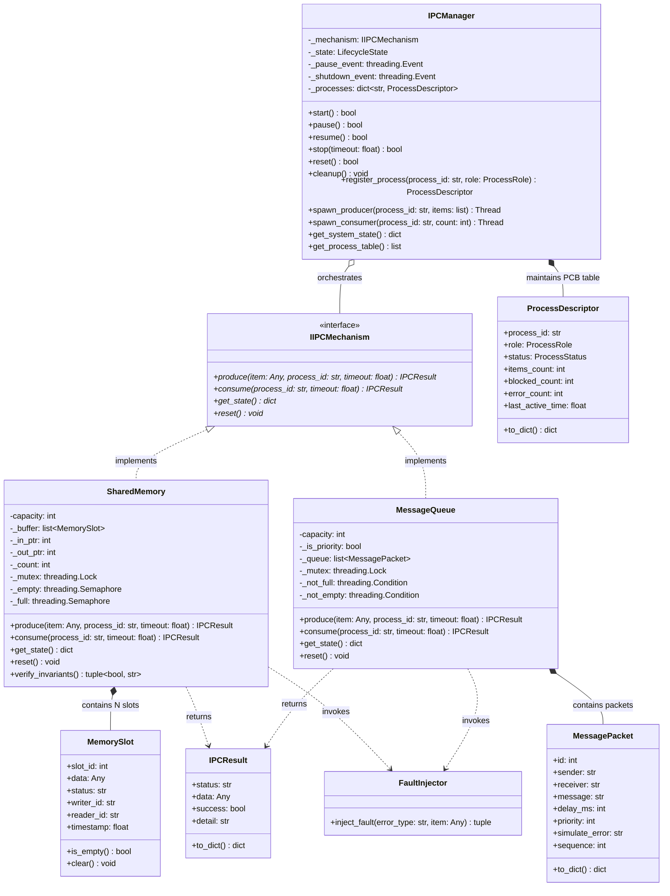
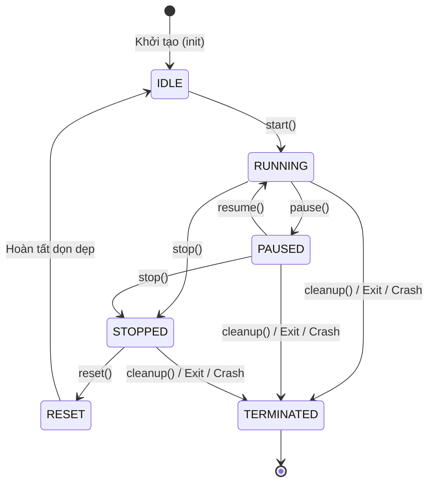

# Mục 3.1. Kiến trúc tổng thể phần mềm và Cơ chế Bộ nhớ chia sẻ (Shared Memory)

> **Mã nhiệm vụ Jira:** `HDH-94`  
> **Tên nhiệm vụ:** Soạn thảo Mục 3.1 Báo cáo: Sơ đồ kiến trúc tổng thể phần mềm (UML Package Diagram, Class Diagram), luồng điều khiển của IPC Manager và cơ chế chia sẻ bộ nhớ.  
> **Người thực hiện:** Hoàng Nam (PM)  
> **Mốc đối chiếu:** Nhánh `develop` và mã nguồn triển khai tại `src/core/ipc_manager.py`, `src/core/shared_memory.py`, `src/core/message_queue.py`.

---

## 3.1.1. Sơ đồ kiến trúc tổng thể phần mềm (UML Package Diagram)

Hệ thống mô phỏng truyền thông liên tiến trình (IPC Simulator) được thiết kế theo mô hình kiến trúc phân tầng 3 lớp (3-Tier Decoupled Architecture), tách bạch hoàn toàn giữa giao diện hiển thị (Presentation Layer), tầng điều phối & tiện ích (Orchestration & Utility Layer), và tầng thuật toán lõi IPC (Core IPC Layer).

```mermaid
flowchart TD
    subgraph UI_Layer["Tầng Giao diện (Presentation Layer - src/gui)"]
        MW["MainWindow<br/>(Cửa sổ chính PyQt6)"]
        SC["SimulationController<br/>(Điều phối hoạt cảnh đa luồng)"]
        MSW["MemorySlotsWidget<br/>(Trực quan hóa ô nhớ Circular Buffer)"]
        TTW["TraceTableWidget<br/>(Bảng nhật ký sự kiện thời gian thực)"]
        MW --> SC
        MW --> MSW
        MW --> TTW
    end

    subgraph Orchestration_Layer["Tầng Điều phối & Tiện ích (src/core, src/utils)"]
        IPCM["IPCManager<br/>(Quản lý vòng đời & PCB)"]
        MC["MetricsCalculator<br/>(Tính Throughput, Latency, Drop Rate)"]
        CP["CSVParser & Reader<br/>(Kiểm tra cú pháp & nạp kịch bản)"]
    end

    subgraph Core_Layer["Tầng Lõi Thuật toán IPC (Core IPC Engine - src/core)"]
        IIPC["«Interface»<br/>IIPCMechanism"]
        SHM["SharedMemory<br/>(Bounded Circular Buffer + Mutex/Semaphores)"]
        MQ["MessageQueue<br/>(Monitor Pattern + FIFO / Priority Queue)"]
        FI["FaultInjector<br/>(Chèn lỗi: Delay, Checksum, Corrupt)"]
        TL["TraceLogger (log_trace)<br/>(Ghi vết vi sự kiện nano giây)"]
        
        IIPC <|.. SHM
        IIPC <|.. MQ
    end

    SC -.->|"Điều phối thực thi"| IPCM
    SC -.->|"Đọc kịch bản"| CP
    IPCM -->|"Quản lý & gọi API"| IIPC
    SHM -.->|"Ghi vết"| TL
    MQ -.->|"Ghi vết"| TL
    SHM -.->|"Mô phỏng lỗi"| FI
    MQ -.->|"Mô phỏng lỗi"| FI
    TL -.->|"Đẩy sự kiện thô"| MC
```

### Chi tiết các gói chức năng (Packages)
1. **Gói Giao diện (`src.gui`):** Chịu trách nhiệm trực quan hóa toàn bộ tiến trình IPC lên màn hình Desktop thông qua PyQt6. Cung cấp bảng điều khiển nạp file CSV, tùy chọn cơ chế IPC, nút bấm điều khiển (Play, Pause, Step-by-step, Reset) và các widget vẽ trạng thái con trỏ mảng vòng `in_ptr`, `out_ptr`. Hoạt động thông qua `QThreadPool` và `QTimer` nhằm đảm bảo Main UI Thread không bao giờ bị đơ (frozen/lag).
2. **Gói Điều phối & Vòng đời (`IPCManager`):** Đóng vai trò là hạt nhân điều phối vòng đời của toàn bộ hệ sinh thái IPC. Quản lý bảng các tiến trình con (Process Table / PCB Table), khởi tạo Producer/Consumer workers, kiểm soát các trạng thái Start, Pause, Resume, Stop, Reset, và kích hoạt cơ chế giải phóng 100% tài nguyên bộ nhớ khi thoát đột ngột.
3. **Gói Thuật toán Lõi (`src.core`):** Cài đặt độc lập toàn bộ các cấu trúc dữ liệu và giải thuật đồng bộ hóa kinh điển của Hệ điều hành. Bao gồm lớp trừu tượng `IIPCMechanism`, cơ chế `SharedMemory` (Circular Buffer với Mutex và Counting Semaphores), cơ chế `MessageQueue` (Monitor Pattern hỗ trợ FIFO/Priority), bộ chèn lỗi `FaultInjector` và cơ chế ghi vết tầng nano giây `log_trace`.
4. **Gói Tiện ích Dữ liệu (`src.utils`):** Chứa các bộ tiền xử lý CSV (`CSVParser`, `CSVReader`), kiểm tra tính hợp lệ dữ liệu (Schema Validation, Guard Clause chặn chuỗi > 100 ký tự, kiểm tra giá trị delay/priority) trước khi đưa vào hệ thống.

---

## 3.1.2. Sơ đồ lớp chi tiết (UML Class Diagram)

Sơ đồ lớp dưới đây thể hiện cấu trúc hướng đối tượng, các giao diện chuẩn hóa và mối liên kết chặt chẽ giữa các thành phần cốt lõi:



---

## 3.1.3. Luồng điều khiển và Quản lý vòng đời của IPC Manager

### Máy trạng thái vòng đời hệ thống (Lifecycle State Machine)
`IPCManager` duy trì tính nhất quán của hệ thống thông qua một máy trạng thái hữu hạn (FSM) gồm 6 trạng thái:

| Trạng thái | Ý nghĩa | Hành vi cho phép |
| :--- | :--- | :--- |
| **`IDLE`** | Hệ thống mới khởi tạo hoặc vừa hoàn tất Reset. | Cho phép cấu hình, đăng ký tiến trình; sẵn sàng nhận lệnh `start()`. |
| **`RUNNING`** | Hệ thống đang điều phối các Producer/Consumer hoạt động. | Cho phép gửi/nhận tin qua `produce()` / `consume()`; có thể gọi `pause()`, `stop()`. |
| **`PAUSED`** | Hệ thống tạm dừng thực thi; bảo lưu toàn vẹn tài nguyên bộ nhớ. | Các worker luồng tự chặn tại `wait_if_paused()`; có thể gọi `resume()` hoặc `stop()`. |
| **`STOPPED`** | Toàn bộ worker đã nhận tín hiệu dừng và kết thúc an toàn. | Có thể gọi `reset()` để tái sử dụng hoặc gọi `cleanup()` để hủy. |
| **`RESET`** | Đang xóa sạch bộ đệm, khôi phục Mutex/Semaphores về mặc định. | Chuyển tiếp tự động về `IDLE`. |
| **`TERMINATED`** | Toàn bộ tài nguyên bộ nhớ, khóa và luồng đã được giải phóng 100%. | Trạng thái cuối (Dead state) của Manager. |



### Điều phối Producer / Consumer và Khối Quản lý Tiến trình (PCB)
Trong hệ điều hành thực tế, mỗi tiến trình được theo dõi thông qua một Khối quản lý tiến trình (Process Control Block - PCB). Trong mô phỏng này, `ProcessDescriptor` đóng vai trò là một PCB độc lập với các trường thông tin:
- `process_id`: Tên định danh tiến trình (ví dụ: `Proc_A`, `Consumer_1`).
- `role`: Vai trò chức năng (`PRODUCER` hoặc `CONSUMER`).
- `status`: Trạng thái tức thời (`CREATED`, `RUNNING`, `BLOCKED`, `PAUSED`, `FINISHED`, `TERMINATED`, `ERROR`).
- `items_count`: Tổng số gói tin đã sản xuất / tiêu thụ thành công.
- `blocked_count`: Số lần tiến trình rơi vào trạng thái nghẽn (`BLOCKED`) do bộ đệm đầy hoặc rỗng.
- `last_active_time`: Dấu thời gian ghi nhận thao tác IPC gần nhất của tiến trình.

### Cơ chế Giải phóng 100% Tài nguyên khi Thoát Đột ngột (Fail-safe Resource Cleanup)
Một trong những lỗi nghiêm trọng nhất trong các hệ thống IPC thực tế là rò rỉ vùng nhớ chia sẻ (Shared Memory Leak) hoặc Deadlock do tiến trình chết đột ngột khi đang giữ Mutex hoặc chiếm giữ Semaphore tokens.

Để giải quyết triệt để vấn đề này theo yêu cầu của Jira **HDH-93**, `IPCManager` tích hợp cơ chế giải phóng tài nguyên đa tầng:
1. **Đăng ký Hook thoát hệ thống (`atexit`):** Tự động liên kết `atexit.register(self.cleanup)` ngay khi khởi tạo instance. Dù chương trình kết thúc tự nhiên qua `sys.exit()` hay kết thúc do unhandled exception, hàm `cleanup()` vẫn luôn được kích hoạt.
2. **Bắt tín hiệu ngắt phần cứng / hệ điều hành (`SIGINT`, `SIGTERM`):** Bắt trực tiếp tín hiệu Ctrl+C từ bàn phím hoặc lệnh `kill` từ hệ điều hành. Khi nhận tín hiệu, handler lập tức kích hoạt dọn dẹp bộ nhớ trước khi chuyển tiếp tín hiệu gốc.
3. **Quy trình thu hồi tài nguyên 100% (Clean-up Protocol):**
   - Bật cờ `_shutdown_event.set()` và giải phóng cờ `_pause_event.set()` để đánh thức tất cả các thread đang bị kẹt hoặc ngủ đông.
   - Chuyển toàn bộ PCB trong bảng tiến trình sang trạng thái `TERMINATED`.
   - Thu hồi vùng nhớ đệm: Gọi `reset()` trên `SharedMemory` hoặc `MessageQueue`, xóa sạch mảng slots về trạng thái rỗng, hoàn trả toàn bộ token Semaphore (`empty = capacity`, `full = 0`), xóa bỏ con trỏ tham chiếu đến payload để Garbage Collector của Python thu hồi RAM ngay lập tức.
   - Chờ các worker kết thúc với timeout an toàn (`join(timeout=0.1)`), đảm bảo không để lại zombie threads.
   - Tính lũy đẳng (Idempotency): Phương thức `cleanup()` được bảo vệ bằng khóa đoạn găng và cờ `_cleaned_up`, cho phép gọi nhiều lần mà không phát sinh ngoại lệ.
4. **Hỗ trợ Context Manager (`with IPCManager(...) as mgr:`):** Cho phép bao bọc luồng thực thi trong khối `with`, bảo đảm tài nguyên luôn được thu hồi kể cả khi có ngoại lệ xảy ra trong thân mã lệnh.

---

## 3.1.4. Cơ chế Bộ nhớ chia sẻ (Shared Memory Bounded Buffer)

### Kiến trúc Mảng nhớ vòng (Circular Bounded Buffer)
Bộ nhớ chia sẻ được hiện thực dưới dạng mảng vòng có kích thước cố định $N = \text{capacity}$. Mỗi ô nhớ trong mảng là một thực thể `MemorySlot` có các trường trạng thái: `EMPTY`, `OCCUPIED`, `LOCKED`, `READING`, `WRITING`.

Việc truy cập bộ đệm tuần hoàn được điều khiển bởi hai con trỏ nguyên:
- **`in_ptr` (Con trỏ ghi của Producer):** Trỏ tới vị trí ô nhớ tiếp theo sẽ được ghi dữ liệu. Sau khi ghi thành công một ô, con trỏ tịnh tiến theo công thức:
  $$\text{in\_ptr} = (\text{in\_ptr} + 1) \pmod N$$
- **`out_ptr` (Con trỏ đọc của Consumer):** Trỏ tới vị trí ô nhớ tiếp theo sẽ được đọc dữ liệu. Sau khi đọc xong, con trỏ tịnh tiến theo công thức:
  $$\text{out\_ptr} = (\text{out\_ptr} + 1) \pmod N$$

```text
    +-----------+-----------+-----------+-----------+-----------+
    |  Slot 0   |  Slot 1   |  Slot 2   |  Slot 3   |  Slot 4   |
    | (OCCUPIED)| (OCCUPIED)|  (EMPTY)  |  (EMPTY)  |  (EMPTY)  |
    +-----------+-----------+-----------+-----------+-----------+
          ^                       ^
          |                       |
       out_ptr                  in_ptr
    (Đọc tại đây)           (Ghi tại đây)
```

### Mô hình Đồng bộ hóa cổ điển (Mutex và Counting Semaphores)
Để bảo vệ đoạn găng truy cập vào mảng nhớ dùng chung và giải quyết bài toán Bounded-Buffer kinh điển của Dijkstra, hệ thống sử dụng 3 biến đồng bộ:

1. **`mutex` (`threading.Lock`):** Khóa nhị phân bảo đảm tính loại trừ tương hỗ (Mutual Exclusion). Tại một thời điểm, chỉ duy nhất một tiến trình (Producer hoặc Consumer) được phép vào đoạn găng để đọc/ghi ô nhớ và cập nhật con trỏ `in_ptr` / `out_ptr`.
2. **`empty` (`threading.Semaphore`):** Semaphore đếm số ô nhớ còn trống trong bộ đệm.
   - Giá trị khởi tạo: $\text{empty} = N$.
   - Producer trước khi ghi phải gọi `empty.acquire()`. Nếu $\text{empty} = 0$, bộ đệm đã đầy (Buffer Overflow), Producer sẽ bị chặn (`BLOCKED`).
   - Consumer sau khi đọc xong một phần tử sẽ gọi `empty.release()` để tăng số ô trống.
3. **`full` (`threading.Semaphore`):** Semaphore đếm số ô nhớ đang chứa dữ liệu khả dụng.
   - Giá trị khởi tạo: $\text{full} = 0$.
   - Consumer trước khi đọc phải gọi `full.acquire()`. Nếu $\text{full} = 0$, bộ đệm đang rỗng (Buffer Underflow), Consumer sẽ bị chặn (`BLOCKED`).
   - Producer sau khi ghi xong một phần tử sẽ gọi `full.release()` để báo hiệu có dữ liệu mới.

### Bất biến toán học của hệ thống (System Invariants)
Hệ thống luôn duy trì và tự động kiểm chứng các bất biến sau thông qua hàm `verify_invariants()`:
$$0 \le \text{count} \le N$$
$$\text{count} + \text{empty\_count} = N$$
$$\text{in\_ptr} = (\text{out\_ptr} + \text{count}) \pmod N$$

### Kỹ thuật Rollback Semaphore phòng tránh Deadlock và Rò rỉ Tài nguyên
Một rủi ro kinh điển trong lập trình hệ thống: Nếu Producer đã `acquire()` thành công Semaphore `empty`, nhưng sau đó bị quá thời gian chờ (timeout) khi cố lấy `mutex`, nếu tiến trình từ bỏ mà không hoàn trả token Semaphore thì biến `empty` sẽ bị mất 1 đơn vị vĩnh viễn (Semaphore Token Leak). Sau $N$ lần xảy ra tình trạng này, hệ thống sẽ rơi vào Deadlock toàn cục dù bộ đệm thực tế vẫn đang rỗng.

Trong mã nguồn `src/core/shared_memory.py`, kỹ thuật Rollback được triển khai chặt chẽ:
```python
# Ví dụ luồng Rollback an toàn khi tranh chấp khóa Mutex thất bại:
if not self._empty.acquire(timeout=timeout):
    return IPCResult(status=IPCStatus.BLOCKED.value, success=False, detail="Buffer đầy")

# Cố gắng lấy Mutex
if not self._mutex.acquire(timeout=remaining_time):
    # Tranh chấp Mutex thất bại -> Lập tức Rollback hoàn trả token Semaphore!
    self._empty.release()
    log_trace("ROLLBACK_EMPTY_SEMAPHORE", f"Process: {process_id}")
    return IPCResult(status=IPCStatus.TIMEOUT.value, success=False, detail="Tranh chấp Mutex thất bại")
```

---

## 3.1.5. Đối chiếu giữa Hệ thống Mô phỏng và Cơ chế IPC Thực tế trong Hệ điều hành

Nhằm phục vụ mục đích kiểm chứng học thuật và đánh giá bảo vệ đồ án, bảng dưới đây đối chiếu chi tiết giữa hiện thực của dự án và cơ chế nhân (Kernel Mode IPC) trong Hệ điều hành Linux / Windows:

| Tiêu chí | Mô hình Mô phỏng của Đồ án (User Mode) | Cơ chế Thực tế của Hệ điều hành (POSIX / Kernel Mode) |
| :--- | :--- | :--- |
| **Không gian nhớ** | Bộ nhớ Heap của tiến trình Python, quản lý bởi mảng đối tượng `MemorySlot`. | Các khung trang vật lý (Physical Page Frames) dùng chung, ánh xạ vào bảng trang (Page Table) của các PCB riêng biệt (`shmget`, `shmat`, `mmap`). |
| **Cơ chế Đồng bộ** | `threading.Lock` và `threading.Semaphore` chạy trên User Space. | POSIX Semaphores nhân (`sem_open`, `sem_wait`, `sem_post`) hoặc Futex (Fast Userspace Mutex) tối ưu hóa của Linux. |
| **Xử lý nghẽn (Blocking)** | Hỗ trợ cờ `timeout=0.0` trả về trạng thái `BLOCKED` để GUI cập nhật animation mượt mà không bị treo. | Tiến trình chuyển trạng thái từ `Running` sang `Waiting` trong danh sách hàng đợi của HĐH và nhường CPU (Context Switch). |
| **Thu hồi khi tiến trình sập** | `IPCManager.cleanup()` tự động dọn dẹp qua `atexit` và bắt tín hiệu `SIGINT`/`SIGTERM`. | Nhân HĐH tự động giảm tham chiếu đếm (`shm_nattch`). Nếu không có tiến trình nào gắn kết và cờ `IPC_RMID` được bật, vùng nhớ sẽ được nhân thu hồi. |
| **Khả năng Ghi vết** | Module `log_trace` ghi trực tiếp dấu thời gian chính xác tới nano giây vào file CSV và phát tín hiệu cho GUI. | Ghi vết hệ thống tầng nhân thông qua các công cụ `ftrace`, `strace`, `eBPF` hoặc DTrace. |
