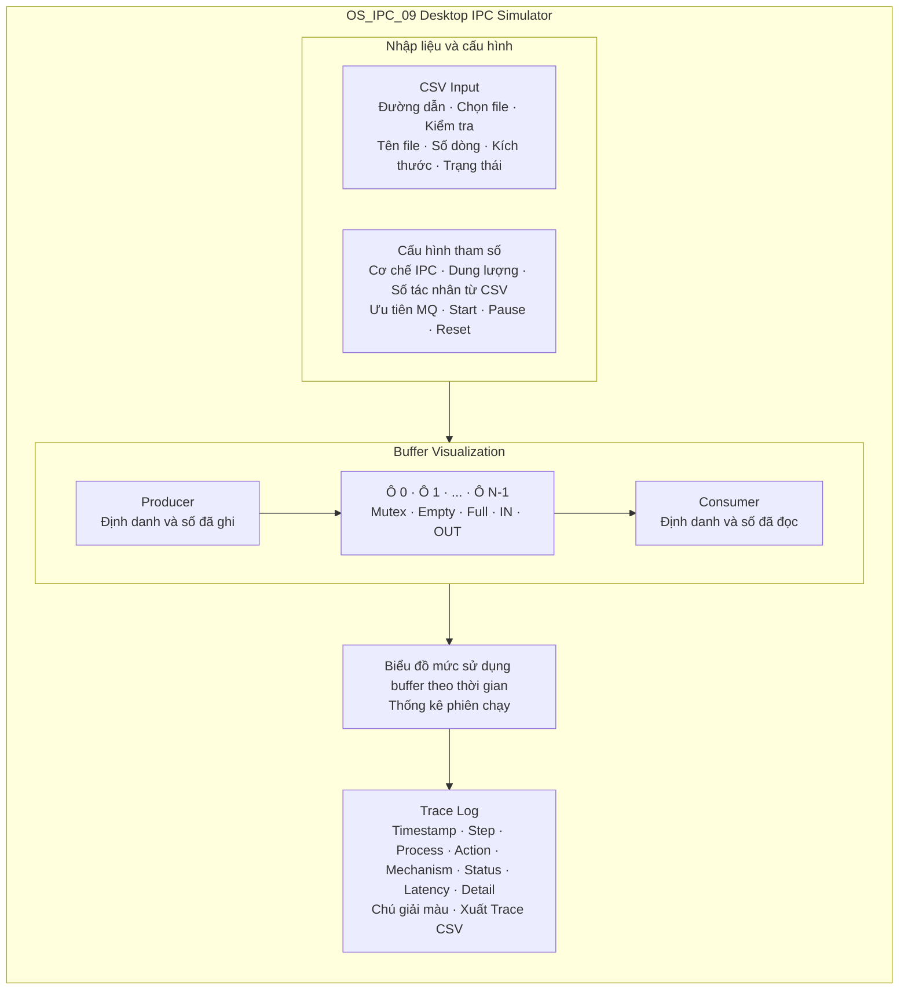
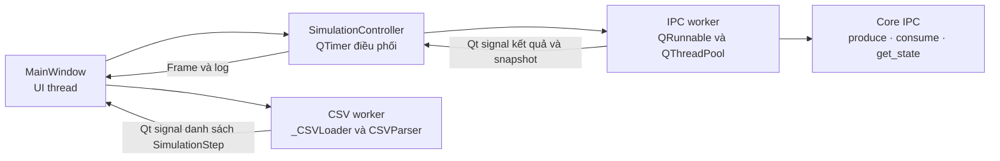
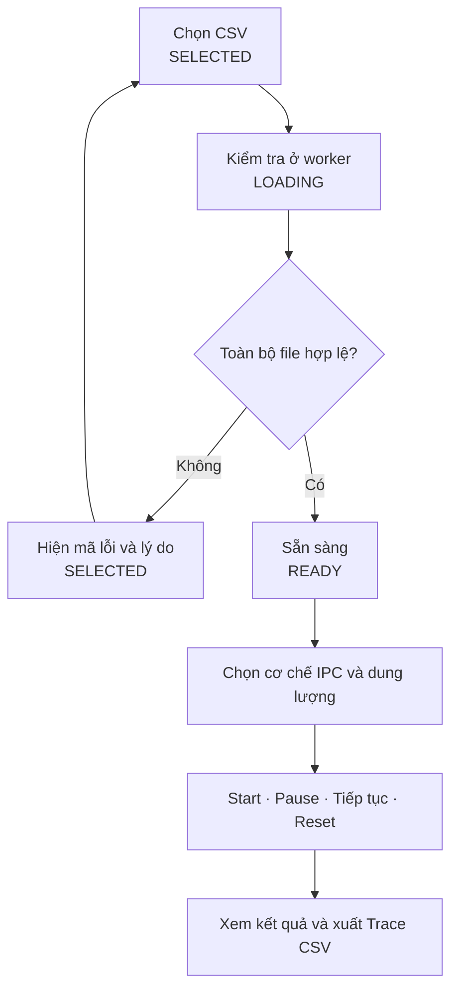

# 3.3 Thiết kế giao diện GUI và module CSV Parser

> **Nhiệm vụ:** HDH-98.  
> **Phạm vi:** Thiết kế GUI, wireframe, cấu trúc CSV Parser và quy trình tương tác nạp file cấu hình.  
> **Mốc đối chiếu:** `develop` tại `f0f3776`; phần GUI bổ sung theo HDH-97 tại `dcdd32d`, cần tích hợp qua PR riêng.

Giao diện Desktop PyQt6 cho phép người dùng nạp kịch bản CSV, lựa chọn cơ chế IPC, quan sát bộ đệm và theo dõi kết quả từng thao tác. Thiết kế kết hợp dữ liệu đã kiểm tra với snapshot từ Core để thể hiện đúng trạng thái mô phỏng và giúp người học đối chiếu hành vi Producer – Consumer.

## 3.3.1 Mục tiêu và bố cục giao diện

Cửa sổ chính được tổ chức thành bốn vùng: CSV Input, Cấu hình tham số, Buffer Visualization và Trace Log. Các vùng nhập đặt phía trên, bộ đệm ở giữa và nhật ký phía dưới. QScrollArea bao quanh nội dung để người dùng tiếp cận đầy đủ thành phần khi thu nhỏ cửa sổ.



*Hình 3.3.1 Wireframe giao diện mô phỏng IPC*

Vùng CSV hiển thị đường dẫn, tên, kích thước, số dòng và kết quả kiểm tra. Vùng cấu hình cho phép chọn Shared Memory hoặc Message Queue, dung lượng 1–1024 ô và chế độ ưu tiên khi dùng Message Queue. Số Producer và Consumer được đếm từ CSV; các ô số lượng này không chỉnh trực tiếp.

Các nút Start, Pause, Tiếp tục và Reset điều khiển phiên chạy. Pipe hiện bị vô hiệu hóa vì chưa có bộ chạy hỗ trợ; giao diện hiện chưa có nút Step riêng. Wireframe chi tiết được lưu trong [docs/HDH-17_IPC_Wireframe_Detailed.drawio](HDH-17_IPC_Wireframe_Detailed.drawio).

## 3.3.2 Trạng thái bộ nhớ và nhật ký thời gian thực

BufferSlots vẽ từng ô bằng QPainter, kèm chỉ số ô và mã thông điệp. Khi dung lượng lớn, widget phân trang bằng cuộn chuột hoặc phím trái/phải và tự chuyển khung nhìn đến ô đang hoạt động. Tooltip cho phép xem nội dung đầy đủ.

| Trạng thái | Nhãn và màu | Ý nghĩa |
| --- | --- | --- |
| EMPTY | Trống · xám | Snapshot không có dữ liệu tại ô. |
| LOCKED | Đang khóa · vàng | Frame ghi nhận tác nhân đã giữ mutex để truy cập ô. |
| WRITING | Đang ghi · tím | Frame ngay trước khi ghi dữ liệu vào ô. |
| WRITTEN | Đã ghi · xanh lá | Ô chứa dữ liệu sau thao tác ghi. |
| READING | Đang đọc · xanh dương | Frame ghi nhận Consumer đọc dữ liệu của ô. |

Chuỗi ghi điển hình là EMPTY → LOCKED → WRITING → WRITTEN; chuỗi đọc là WRITTEN → LOCKED → READING → EMPTY. Core thu thập frame trong thao tác rồi giải phóng mutex trước khi GUI phát lại. Nhãn khóa thể hiện snapshot lịch sử của frame; animation không giữ khóa thật trong thời gian hiển thị.

Hàng thông tin đồng bộ hiển thị Mutex, Empty, Full, IN và OUT của Shared Memory. Với Message Queue, giao diện hiển thị loại hàng đợi FIFO/Priority và số chỗ trống/tin nhắn. Sau mỗi bước, snapshot cuối thay thế trạng thái tạm của ô.

### Bảng Trace Log

| Kết quả | Màu dòng | Ý nghĩa |
| --- | --- | --- |
| SUCCESS | Xanh lá | Thao tác thành công. |
| BLOCKED | Vàng | Thao tác không thực hiện được ngay, ví dụ buffer đầy/rỗng. |
| TIMEOUT | Cam | Hết thời gian chờ nếu bộ chạy cung cấp trạng thái này. |
| ERROR | Đỏ | Lỗi thao tác hoặc ngoại lệ khi gọi Core. |

Bảng giữ chín cột: #, Timestamp, Step, Process, Action, Mechanism, Status, Latency (ms), Detail. Process lấy từ sender của dòng CSV, kể cả thao tác CONSUME. Latency đo thao tác Core và thu thập snapshot, không cộng animation. Bộ chạy GUI dùng timeout=0.0 nên tình huống đầy/rỗng thông thường trả BLOCKED.

Log mới được thêm qua Qt signal/slot. Bảng theo dõi dòng mới khi đang ở cuối, giữ vị trí khi người dùng cuộn lên, và cung cấp tooltip cho nội dung dài. Xuất CSV dùng UTF-8 BOM để giữ dấu tiếng Việt, dấu phẩy, dấu nháy và nội dung nhiều dòng. Log này ghi kết quả từng bước; log vi sự kiện của Core là đầu ra riêng.

## 3.3.3 Kiến trúc GUI và cấu trúc CSV Parser

MainWindow nhận thao tác và hiển thị dữ liệu; SimulationController điều phối thứ tự bước; Core hiện thực thuật toán IPC qua produce(), consume() và get_state(). Thiết kế HDH-97 chạy thao tác Core trong QRunnable trên QThreadPool và phát kết quả về UI thread. QTimer chỉ lập lịch delay_ms và phát lại frame, giúp GUI tiếp tục xử lý sự kiện khi Core chạy chậm.



*Hình 3.3.2 Phân tách giao diện điều khiển và các worker*

CSVParser trong [src/utils/csv_parser.py](../src/utils/csv_parser.py) độc lập với GUI. parse(file_path) trả danh sách SimulationStep theo thứ tự bản ghi trong file, không sắp xếp theo ID. SimulationStep là dataclass bất biến. Các hàm _validate_header(), _parse_row() và _parse_int() lần lượt kiểm tra header, một bản ghi và giá trị số nguyên.

| Trường | Bắt buộc | Quy tắc hiện có |
| --- | --- | --- |
| id | Có | Số nguyên dương và duy nhất trong toàn file. |
| action | Có | PRODUCE, CONSUME, SEND hoặc RECEIVE; phân biệt chữ hoa/thường. |
| sender | Có | Không rỗng sau khi bỏ khoảng trắng hai đầu; tác nhân thực hiện bước. |
| receiver | Có | Không rỗng sau khi bỏ khoảng trắng hai đầu. |
| message | Không | Mặc định rỗng; giữ khoảng trắng; phải rỗng khi CONSUME/RECEIVE. |
| delay_ms | Không | Số nguyên không âm; thiếu hoặc ô rỗng lấy 0. |
| priority | Không | Số nguyên; thiếu hoặc ô rỗng lấy 0; parser không giới hạn 0–5. |
| simulate_error | Không | Bỏ khoảng trắng, đổi chữ hoa; mặc định NONE; chưa kiểm tra tập giá trị. |

GUI gọi CSVParser qua _CSVLoader, chuyển từng SimulationStep sang dict bằng asdict() rồi phát tín hiệu finished. Module csv_reader.py vẫn cung cấp read_messages() cho các nơi gọi khác; MainWindow không dùng module này để nạp file.

## 3.3.4 Kiểm tra dữ liệu và hợp đồng kết quả

Parser dùng csv.DictReader(strict=True), encoding utf-8-sig và newline="". File UTF-8 có hoặc không BOM, thông điệp chứa dấu phẩy, dấu nháy và xuống dòng được chấp nhận khi tuân thủ cú pháp CSV. Các dòng trống được bỏ qua; file rỗng hoặc chỉ có header bị từ chối.

**1. Kiểm tra header.** Yêu cầu đủ id, action, sender, receiver; cấm tên cột trùng và cột không hỗ trợ. Thứ tự các cột có thể thay đổi, nhưng tên cột phải đúng.

**2. Kiểm tra bản ghi.** Số ô phải khớp header. Parser kiểm tra trường bắt buộc, số nguyên, ID dương/không trùng, action hợp lệ và quy tắc message của thao tác đọc.

**3. Chấp nhận toàn bộ file.** Chỉ trả dữ liệu sau khi mọi dòng đều hợp lệ. Một dòng lỗi làm toàn bộ lần nạp thất bại; GUI nhận data rỗng và không cho chạy dữ liệu đọc dở. Lỗi bản ghi có thông tin dòng/cột; với message nhiều dòng, số dòng là dòng cuối của bản ghi.

| Mã kết quả | Nguồn | Phản hồi trên GUI |
| --- | --- | --- |
| OK | Đọc và xác thực thành công | Hiện CSV hợp lệ, số dòng và số tác nhân; bật Start. |
| INVALID_DATA | ValueError | Hiện lý do lỗi dữ liệu; giữ Start tắt. |
| INVALID_CSV | csv.Error | Hiện chi tiết cú pháp CSV; cho phép chọn và kiểm tra lại. |
| FILE_READ_ERROR | OSError / UnicodeError | Hiện lỗi đọc file hoặc encoding; cho phép chọn lại file. |

Kết quả worker gồm success, error_code, detail và data. Khi lỗi, success=False và data=[]. Khi thành công, error_code="OK" và data là danh sách bước mô phỏng.

### Ví dụ kịch bản hợp lệ

```csv
id,action,sender,receiver,message,delay_ms,priority
1,PRODUCE,P1,C1,"Xin chào, IPC",500,0
2,CONSUME,C1,P1,,500,0
```

Trong giao diện hiện tại, nạp file cấu hình là nạp kịch bản thao tác CSV. [sample_config.csv](../data/input/sample_config.csv) cũng dùng schema trên. Cơ chế IPC, dung lượng và chế độ ưu tiên được chọn trên GUI; chưa có luồng nạp file tham số hệ thống riêng.

Các tầng kiểm tra bổ sung được giữ tách biệt: controller giới hạn delay_ms đến 2.147.483.647 để tương thích QTimer; Guard của Shared Memory từ chối payload dài hơn 100 ký tự khi chạy. Hai kiểm tra này không phải kết quả xác thực của CSVParser.

## 3.3.5 Quy trình tương tác người dùng



*Hình 3.3.3 Quy trình nạp kiểm tra và chạy kịch bản*

**1. Chọn file.** Người dùng nhấn Chọn file và chọn CSV. GUI cập nhật đường dẫn, tên và kích thước, xóa dữ liệu cũ và chuyển SELECTED. Hủy hộp thoại giữ nguyên lựa chọn hiện tại.

**2. Kiểm tra.** Nhấn Kiểm tra để chuyển LOADING. _CSVLoader chạy nền; GUI khóa thao tác có thể thay đổi đầu vào. Nếu có lỗi, giao diện hiện mã lỗi và lý do để người dùng sửa hoặc chọn lại file.

**3. Cấu hình.** Khi READY, chọn Shared Memory hoặc Message Queue và dung lượng buffer. Số Producer/Consumer được đếm từ các sender phân biệt trong nhóm thao tác tương ứng. Chế độ ưu tiên chỉ bật với Message Queue.

**4. Bắt đầu.** Start xóa log và thống kê của lần chạy trước, tạo Core mới và lên lịch theo thứ tự CSV. Mỗi bước gọi Core với timeout=0.0. Thiết kế HDH-97 dùng worker và đặt delay_ms=0 trong bản sao gửi Core vì QTimer đã áp dụng độ trễ của kịch bản.

**5. Theo dõi kết quả.** GUI phát lại frame, cập nhật ô nhớ, biến đồng bộ, mức sử dụng, tiến độ và log. Kết quả BLOCKED được ghi nhận rồi chuyển bước tiếp theo, không retry tự động. Ngoại lệ khi gọi Core sinh dòng ERROR và kết thúc phiên.

**6. Pause và tiếp tục.** Pause dừng timer và giữ khung hình cùng thời gian chờ còn lại. Worker đã bắt đầu có thể hoàn tất ở nền; kết quả được giữ để phát lại khi tiếp tục. Nút Start đổi thành Tiếp tục trong trạng thái PAUSED.

**7. Reset hoặc chạy lại.** Reset xóa log, thống kê, timer và trạng thái tạm nhưng giữ CSV đã kiểm tra. Mã thế hệ của controller loại bỏ kết quả về muộn của phiên cũ; không cưỡng bức ngắt thread. Khi hết kịch bản, GUI trở lại READY và giữ kết quả để xem hoặc xuất.

**8. Xuất nhật ký.** Khi có ít nhất một dòng log, nút Xuất Trace CSV được bật. Người dùng chọn nơi lưu; lỗi ghi file được báo trên thanh trạng thái để có thể chọn đường dẫn khác và thử lại.

## 3.3.6 Máy trạng thái và kiểm chứng thiết kế

| Trạng thái | Điều kiện | Thao tác chính |
| --- | --- | --- |
| EMPTY | Chưa chọn file | Chọn file, chỉnh tham số; Start/Pause/Reset tắt. |
| SELECTED | Đã chọn hoặc kiểm tra lỗi | Chọn file, Kiểm tra, chỉnh tham số; Start tắt. |
| LOADING | Đang kiểm tra CSV | Khóa chọn file, kiểm tra lại và điều khiển chạy. |
| READY | CSV hợp lệ hoặc phiên đã kết thúc | Chọn/kiểm tra file, cấu hình, Start, Reset. |
| RUNNING | Đang chạy kịch bản | Pause và Reset; khóa đầu vào/cấu hình. |
| PAUSED | Người dùng Pause | Tiếp tục hoặc Reset; giữ cấu hình của phiên. |

### Kịch bản kiểm chứng

Kịch bản [test_slots_edges.csv](../data/input/test_slots_edges.csv) với Shared Memory và dung lượng 2 cho phép đối chiếu đầy/rỗng và mảng vòng: bước 3 bị BLOCKED do đầy, bước 6 bị BLOCKED do rỗng, bước 7 ghi lại ô 0. Có thể Pause ở frame ghi để quan sát WRITING, sau đó tiếp tục và Reset để kiểm tra khôi phục giao diện.

Kiểm thử parser bao phủ BOM/Unicode, message nhiều dòng, thiếu/trùng/lạ cột, số ô không khớp, ID trùng và dòng lỗi. Kiểm thử GUI bao phủ nạp nền, Start chỉ bật khi hợp lệ, nạp lại sau lỗi và xuất CSV giữ nguyên nội dung. Các bổ sung của HDH-97 kiểm tra màu toàn dòng, tự cuộn, Core chậm không chặn UI, Pause/Reset khi worker chưa xong và hover sau khi đổi dung lượng.

### Giới hạn của mô hình

Bộ chạy thực hiện tuần tự theo CSV, sử dụng đối tượng và primitive đồng bộ của Python; không tạo tiến trình hệ điều hành độc lập. Biểu đồ phản ánh mức sử dụng buffer. Thông lượng GUI bao gồm lịch biểu và animation nên không thay thế benchmark Core. Nạp file tham số hệ thống riêng, nút Step và bộ chạy Pipe là các khả năng mở rộng.

### Mã nguồn và tài liệu đối chiếu

[src/gui/main_window.py](../src/gui/main_window.py) và [src/gui/widgets.py](../src/gui/widgets.py): bố cục, trạng thái và hiển thị.

[src/gui/simulation_controller.py](../src/gui/simulation_controller.py): điều phối, worker, Pause/Resume/Reset.

[src/utils/csv_parser.py](../src/utils/csv_parser.py): SimulationStep và các quy tắc xác thực.

[tests/test_csv_parser.py](../tests/test_csv_parser.py), [tests/test_main_window.py](../tests/test_main_window.py), [tests/test_simulation_controller.py](../tests/test_simulation_controller.py): kiểm thử hành vi.

[docs/HDH-17_IPC_Wireframe_Detailed.drawio](HDH-17_IPC_Wireframe_Detailed.drawio): wireframe chi tiết.

Mốc mã nguồn: develop f0f3776; thiết kế GUI bổ sung HDH-97 tại dcdd32d.
