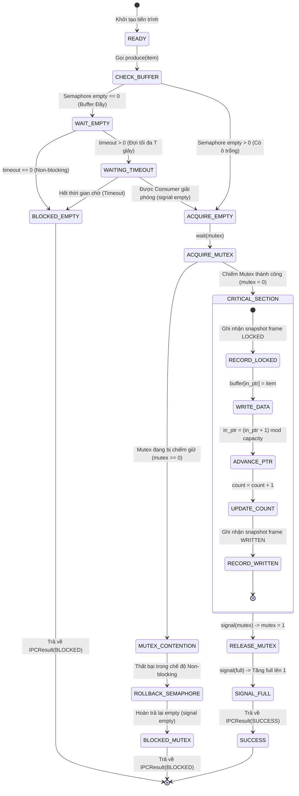
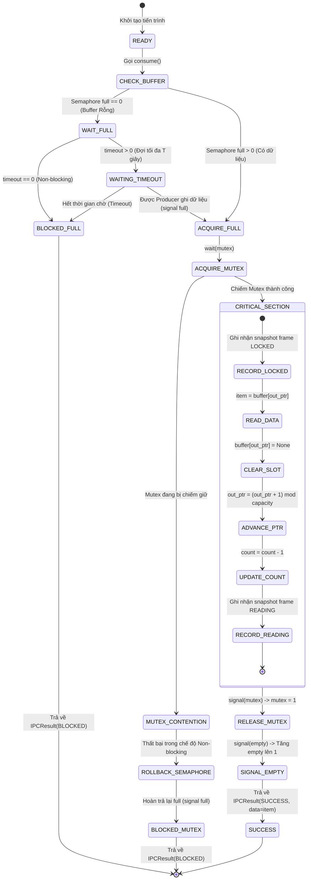
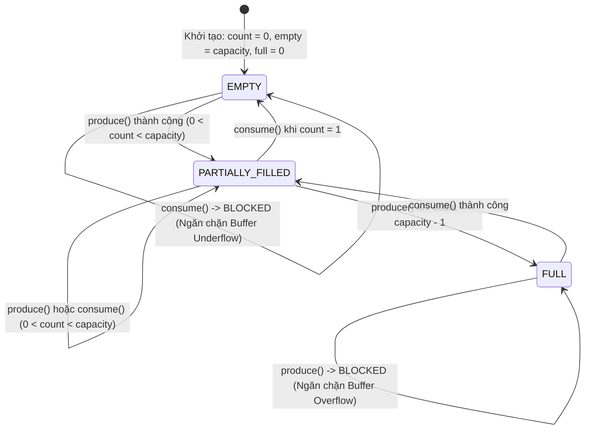

# ĐẶC TẢ KỸ THUẬT & THUẬT TOÁN ĐỒNG BỘ HÓA SHARED MEMORY (BOUNDED BUFFER)

> **Mã nhiệm vụ Jira:** `HDH-10` (Soạn đặc tả ban đầu), `HDH-24` (Hiện thực luồng lõi), `HDH-86` (Cơ chế khóa & chống Deadlock/Starvation), `HDH-87` (Đặc tả thuật toán, State Diagram, Invariants)  
> **Cơ chế IPC:** Vùng nhớ chia sẻ (Shared Memory)  
> **Mô hình kiến trúc:** Bounded Buffer (Mảng vòng - Circular Buffer)  
> **Mô hình đồng bộ:** Dijkstra Counting Semaphores + Mutex Lock (Loại trừ tương hỗ & Báo hiệu tiến trình)  
> **Nền tảng mục tiêu:** Python 3.10+, Desktop GUI PyQt6  

---

## 1. TỔNG QUAN & MỤC TIÊU THIẾT KẾ

Module `SharedMemory` hiện thực cơ chế truyền thông liên tiến trình (IPC) qua vùng nhớ chia sẻ, mô phỏng quá trình trao đổi dữ liệu tốc độ cao giữa nhiều tiến trình **Producer** và **Consumer**.

### Mục tiêu kiến trúc:
1. **Độc lập hoàn toàn khỏi Giao diện (Decoupled Core):** Tầng logic cốt lõi không phụ thuộc vào bất kỳ thư viện UI nào, cho phép kiểm thử độc lập qua Console script hoặc Unit test.
2. **Không gây treo UI (Non-blocking Thread Safety):** Tuyệt đối loại trừ vòng lặp vô tận `while True` hoặc lệnh chờ chặn vô hạn (`wait` blocking) trên luồng chính của PyQt6. Hỗ trợ cơ chế `timeout=0.0` (non-blocking) trả về cờ `BLOCKED` tức thì trong $O(1)$.
3. **An toàn đồng bộ hóa (Race-free, Deadlock-free & Starvation-free):** Sử dụng các nguyên thủy đồng bộ hoá của Hệ điều hành (`threading.Semaphore` và `threading.Lock`) tuân thủ nghiêm ngặt thứ tự Wait/Signal và cơ chế Rollback Semaphore khi tranh chấp Mutex.

---

## 2. CẤU TRÚC DỮ LIỆU (DATA STRUCTURES)

### 2.1. Mảng vòng tuần hoàn (Circular Buffer)
Dữ liệu được tổ chức dưới dạng một mảng một chiều có kích thước cố định $N = \text{capacity}$. Hai con trỏ số nguyên điều hướng tuần hoàn trên mảng:

```
                  in_ptr (Vị trí Producer ghi tiếp theo)
                        │
                        ▼
    ┌──────────┬──────────┬──────────┬──────────┐
    │  Slot 0  │  Slot 1  │  Slot 2  │  Slot 3  │   (Capacity = 4)
    └──────────┴──────────┴──────────┴──────────┘
                        ▲
                        │
                  out_ptr (Vị trí Consumer đọc tiếp theo)
```

- `buffer: list[Any | None]`: Mảng chứa dữ liệu các ô nhớ (khởi tạo `[None] * capacity`).
- `in_ptr: int`: Chỉ số ô nhớ Producer sẽ ghi dữ liệu ở bước tiếp theo ($0 \le \text{in\_ptr} < \text{capacity}$).
- `out_ptr: int`: Chỉ số ô nhớ Consumer sẽ đọc dữ liệu ở bước tiếp theo ($0 \le \text{out\_ptr} < \text{capacity}$).
- `count: int`: Số lượng ô nhớ đang chứa dữ liệu thực tế ($0 \le \text{count} \le \text{capacity}$).

**Quy tắc tịnh tiến con trỏ tuần hoàn (Modulo Arithmetic):**
$$\text{in\_ptr} = (\text{in\_ptr} + 1) \pmod{\text{capacity}}$$
$$\text{out\_ptr} = (\text{out\_ptr} + 1) \pmod{\text{capacity}}$$

### 2.2. Lược đồ trạng thái phục vụ GUI (`get_state`)
Hàm `get_state()` cung cấp bản chụp (snapshot) an toàn luồng với các trường:

| Tên trường (Key) | Kiểu dữ liệu | Ý nghĩa kỹ thuật |
| :--- | :--- | :--- |
| `buffer` | `list[Any]` | Bản sao an toàn của mảng dữ liệu hiện tại (các ô trống mang giá trị `None`). |
| `in_ptr` | `int` | Vị trí con trỏ ghi tiếp theo của Producer. |
| `out_ptr` | `int` | Vị trí con trỏ đọc tiếp theo của Consumer. |
| `mutex` | `int` | Trạng thái khóa Mutex: `1` (Rảnh - Unlocked), `0` (Bận - Locked). |
| `empty` | `int` | Giá trị Semaphore `empty` (Số ô trống khả dụng: $\text{capacity} - \text{count}$). |
| `full` | `int` | Giá trị Semaphore `full` (Số ô có dữ liệu khả dụng: $\text{count}$). |
| `blocked_processes` | `list[str]` | Danh sách định danh các tiến trình hiện đang bị nghẽn (theo thứ tự FIFO). |
| `capacity` | `int` | Sức chứa tối đa của bộ đệm. |
| `count` | `int` | Số phần tử hiện có trong buffer. |
| `mutex_holder` | `str \| None` | Tiến trình hiện đang nắm giữ Mutex trong Critical Section. |
| `step` | `int` | Bộ đếm thao tác tích lũy phục vụ Trace log. |

---

## 3. BIẾN ĐỒNG BỘ HÓA (SYNCHRONIZATION PRIMITIVES)

Để giải quyết triệt để tranh chấp bộ nhớ (Race Condition), bế tắc (Deadlock) và bỏ đói (Starvation), hệ thống sử dụng 3 nguyên thủy đồng bộ:

| Tên biến | Kiểu nguyên thủy | Khởi tạo | Vai trò & Ý nghĩa kỹ thuật |
| :--- | :--- | :---: | :--- |
| `mutex` | Binary Semaphore / Lock | `1` | **Loại trừ tương hỗ (Mutual Exclusion):** Bảo vệ đoạn găng (Critical Section). Đảm bảo tại một thời điểm chỉ có DUY NHẤT một tiến trình được ghi hoặc đọc vào `buffer`, cập nhật `in_ptr`, `out_ptr`, `count`. |
| `empty` | Counting Semaphore | `capacity` | **Đếm ô nhớ trống:** Báo hiệu số vị trí còn trống. Khi $\text{empty} = 0$, bộ đệm đã **ĐẦY**; mọi Producer muốn ghi thêm đều bị chuyển sang trạng thái **BLOCKED** (ngăn chặn Buffer Overflow). |
| `full` | Counting Semaphore | `0` | **Đếm ô nhớ có dữ liệu:** Báo hiệu số vị trí đã có dữ liệu sẵn sàng. Khi $\text{full} = 0$, bộ đệm đang **RỖNG**; mọi Consumer muốn đọc đều bị chuyển sang trạng thái **BLOCKED** (ngăn chặn Buffer Underflow). |

---

## 4. BIỂU ĐỒ CHUYỂN TRẠNG THÁI (STATE TRANSITION DIAGRAMS)

### 4.1. Biểu đồ trạng thái Producer (Nhà sản xuất)



### 4.2. Biểu đồ trạng thái Consumer (Người tiêu thụ)



### 4.3. Biểu đồ trạng thái Vùng đệm Circular Buffer (Finite State Machine)



---

## 5. MÃ GIẢ GIẢI THUẬT (FORMAL PSEUDOCODE)

### 5.1. Thuật toán Producer (Hỗ trợ Non-blocking, Timeout & Rollback Mutex)

```text
Algorithm Produce(item, process_id, timeout, events):
    Input:  item        - Dữ liệu cần ghi vào bộ đệm
            process_id  - Định danh tiến trình thực hiện ghi
            timeout     - Thời gian chờ (0.0: non-blocking, > 0.0: timeout, None: vô hạn)
            events      - Danh sách lưu snapshot phục vụ GUI animation
    Output: IPCResult   - Đối tượng trạng thái SUCCESS hoặc BLOCKED

    // 1. Mô phỏng độ trễ (Fault Injection: DELAY) trước đoạn găng
    if item has simulate_error == "DELAY" or item.delay_ms > 0:
        sleep(item.delay_ms / 1000.0)

    // 2. Chờ và chiếm 1 ô nhớ trống (Wait on Counting Semaphore empty)
    if timeout == 0.0:
        if not try_acquire(empty_semaphore):
            record_blocked(blocked_producers, process_id)
            log_trace("WAIT_EMPTY", process_id)
            return IPCResult(status=BLOCKED, success=False, detail="Buffer đầy")
    else:
        record_blocked(blocked_producers, process_id)
        if not acquire_with_timeout(empty_semaphore, timeout):
            remove_blocked(blocked_producers, process_id)
            log_trace("WAIT_EMPTY_TIMEOUT", process_id)
            return IPCResult(status=BLOCKED, success=False, detail="Timeout chờ ô trống")

    remove_blocked(blocked_producers, process_id)

    // 3. Chiếm khóa Mutex (Wait on Binary Semaphore mutex)
    if timeout == 0.0:
        acquired_mutex = try_acquire(mutex_lock)
    elif timeout is None:
        acquired_mutex = acquire_blocking(mutex_lock)
    else:
        acquired_mutex = acquire_with_timeout(mutex_lock, remaining_timeout)

    // CƠ CHẾ ROLLBACK: Nếu chiếm Mutex thất bại, bắt buộc hoàn trả Semaphore empty
    if not acquired_mutex:
        release(empty_semaphore)  // Hoàn trả ô trống đã chiếm để tránh rò rỉ (Semaphore Leak)!
        record_blocked(blocked_producers, process_id)
        log_trace("MUTEX_BLOCKED", process_id)
        return IPCResult(status=BLOCKED, success=False, detail="Bị nghẽn tại Mutex")

    // 4. Đoạn găng (Critical Section)
    try:
        mutex_holder = process_id
        slot_index = in_ptr
        log_trace("LOCK_ACQUIRE", process_id)

        if events is not None:
            record_event(events, phase="LOCKED", slot=slot_index, process_id=process_id)

        // Xử lý mô phỏng lỗi Checksum nếu có
        if item.simulate_error == "CHECKSUM":
            item.checksum = "ERR_CHECKSUM_FAILED"

        buffer[slot_index] = item
        log_trace("WRITE_SLOT", slot_index)

        in_ptr = (in_ptr + 1) mod capacity
        count = count + 1
        step_counter = step_counter + 1

        if events is not None:
            record_event(events, phase="WRITTEN", slot=slot_index, process_id=process_id)

    finally:
        // 5. Rời khỏi đoạn găng (Signal Mutex)
        mutex_holder = None
        release(mutex_lock)
        log_trace("LOCK_RELEASE", process_id)

    // 6. Báo hiệu có dữ liệu mới cho Consumer (Signal Counting Semaphore full)
    release(full_semaphore)
    log_trace("SIGNAL_FULL", count)

    return IPCResult(status=SUCCESS, success=True, data=item)
```

### 5.2. Thuật toán Consumer (Hỗ trợ Non-blocking, Timeout & Rollback Mutex)

```text
Algorithm Consume(process_id, timeout, events):
    Input:  process_id  - Định danh tiến trình thực hiện đọc
            timeout     - Thời gian chờ
            events      - Danh sách lưu snapshot phục vụ GUI animation
    Output: IPCResult   - Đối tượng trạng thái SUCCESS (kèm data) hoặc BLOCKED

    // 1. Chờ và chiếm 1 ô có dữ liệu (Wait on Counting Semaphore full)
    if timeout == 0.0:
        if not try_acquire(full_semaphore):
            record_blocked(blocked_consumers, process_id)
            log_trace("WAIT_FULL", process_id)
            return IPCResult(status=BLOCKED, success=False, detail="Buffer rỗng")
    else:
        record_blocked(blocked_consumers, process_id)
        if not acquire_with_timeout(full_semaphore, timeout):
            remove_blocked(blocked_consumers, process_id)
            log_trace("WAIT_FULL_TIMEOUT", process_id)
            return IPCResult(status=BLOCKED, success=False, detail="Timeout chờ dữ liệu")

    remove_blocked(blocked_consumers, process_id)

    // 2. Chiếm khóa Mutex (Wait on Binary Semaphore mutex)
    if timeout == 0.0:
        acquired_mutex = try_acquire(mutex_lock)
    elif timeout is None:
        acquired_mutex = acquire_blocking(mutex_lock)
    else:
        acquired_mutex = acquire_with_timeout(mutex_lock, remaining_timeout)

    // CƠ CHẾ ROLLBACK: Nếu chiếm Mutex thất bại, bắt buộc hoàn trả Semaphore full
    if not acquired_mutex:
        release(full_semaphore)  // Hoàn trả để tránh rò rỉ Semaphore
        record_blocked(blocked_consumers, process_id)
        log_trace("MUTEX_BLOCKED", process_id)
        return IPCResult(status=BLOCKED, success=False, detail="Bị nghẽn tại Mutex")

    // 3. Đoạn găng (Critical Section)
    try:
        mutex_holder = process_id
        slot_index = out_ptr
        log_trace("LOCK_ACQUIRE", process_id)

        if events is not None:
            record_event(events, phase="LOCKED", slot=slot_index, process_id=process_id)
            record_event(events, phase="READING", slot=slot_index, process_id=process_id)

        item = buffer[slot_index]
        log_trace("READ_SLOT", slot_index)

        buffer[slot_index] = None   // Xóa sạch ô nhớ sau khi đọc (Clear slot)
        out_ptr = (out_ptr + 1) mod capacity
        count = count - 1
        step_counter = step_counter + 1

    finally:
        // 4. Rời khỏi đoạn găng (Signal Mutex)
        mutex_holder = None
        release(mutex_lock)
        log_trace("LOCK_RELEASE", process_id)

    // 5. Báo hiệu đã giải phóng ô trống cho Producer (Signal Counting Semaphore empty)
    release(empty_semaphore)
    log_trace("SIGNAL_EMPTY", count)

    return IPCResult(status=SUCCESS, success=True, data=item)
```

---

## 6. CHỨNG MINH TOÁN HỌC & BẤT BIẾN HỆ THỐNG (SYSTEM INVARIANTS)

### 6.1. Bất biến Sức chứa (Capacity Invariant)
Tại mọi thời điểm $t$ bên ngoài Critical Section:
$$\text{Semaphore}(empty) + \text{Semaphore}(full) = \text{capacity}$$
$$0 \le \text{count} \le \text{capacity}$$
$$\text{Semaphore}(empty) = \text{capacity} - \text{count}$$
$$\text{Semaphore}(full) = \text{count}$$

*Chứng minh quy nạp:*
- Ban đầu: $\text{count} = 0 \implies \text{empty} = \text{capacity}, \text{full} = 0 \implies \text{empty} + \text{full} = \text{capacity}$.
- Khi Producer ghi 1 phần tử: $\text{empty}$ giảm 1 (qua `wait(empty)`), sau đó $\text{full}$ tăng 1 (qua `signal(full)`), $\text{count}$ tăng 1. Tổng $\text{empty} + \text{full}$ không đổi.
- Khi Consumer đọc 1 phần tử: $\text{full}$ giảm 1 (qua `wait(full)`), sau đó $\text{empty}$ tăng 1 (qua `signal(empty)`), $\text{count}$ giảm 1. Tổng $\text{empty} + \text{full}$ không đổi.

### 6.2. Chứng minh Loại trừ tương hỗ (Mutual Exclusion Proof)
Giả sử có 2 tiến trình $P_1$ và $P_2$ cùng đồng thời nằm trong Critical Section tại thời điểm $t$.
- Để vào Critical Section, mỗi tiến trình đều phải thực thi lệnh `wait(mutex)`.
- Khóa $\text{mutex}$ được khởi tạo giá trị $1$.
- Để $P_1$ vào, $\text{mutex}$ giảm từ $1 \rightarrow 0$.
- Để $P_2$ vào tiếp, `wait(mutex)` trên giá trị $0$ sẽ bị chặn (block) cho đến khi $P_1$ gọi `signal(mutex)` đưa giá trị về $1$.
- Mâu thuẫn với giả thiết cả hai cùng trong Critical Section $\implies$ **Luôn chỉ có tối đa 1 tiến trình trong Critical Section**.

### 6.3. Chứng minh Tránh Bế tắc (Deadlock Freedom & Lock Hierarchy)
Hệ thống tuân thủ nghiêm ngặt **Thứ tự chiếm dụng khóa cố định (Strict Partial Order)**:
$$\text{Counting Semaphore } (empty / full) \prec \text{Binary Semaphore } (mutex)$$
- Producer luôn gọi `wait(empty)` trước, rồi mới gọi `wait(mutex)`.
- Consumer luôn gọi `wait(full)` trước, rồi mới gọi `wait(mutex)`.
- **Phản chứng nếu đảo thứ tự:** Nếu gọi `wait(mutex)` trước `wait(empty)`: Khi buffer đầy, Producer giữ `mutex` rồi đi ngủ ở `wait(empty)`. Consumer cần vào giải phóng ô nhớ phải chiếm `mutex`, nhưng `mutex` đã bị Producer giữ $\implies$ Xảy ra hiện tượng Deadlock vòng tròn (Circular Wait).
- **Kết luận:** Do tuân thủ thứ tự $\text{Counting Semaphore} \prec \text{Mutex}$, điều kiện Circular Wait của Coffman bị triệt tiêu hoàn toàn, bảo đảm hệ thống **Deadlock-free**.

### 6.4. Chứng minh Chống Đói Tiến Trình (Starvation Freedom & Fairness Guarantee)
Hiện tượng đói tiến trình (Starvation) được ngăn chặn triệt để nhờ 3 cơ chế:
1. **Hàng đợi đánh thức FIFO (Fair Queuing):** `threading.Semaphore` và danh sách theo dõi tiến trình `_blocked_producers` / `_blocked_consumers` đều vận hành theo cơ chế hàng đợi FIFO (First-In, First-Out). Tiến trình nào bị block trước sẽ được đánh thức và phục vụ trước ngay khi có ô trống (`empty`) hoặc dữ liệu (`full`).
2. **Cơ chế Timeout hữu hạn:** Hệ thống hỗ trợ tham số `timeout`. Tiến trình không bao giờ bị đông cứng vô hạn nếu bên đối tác ngừng hoạt động.
3. **Tiến trình không giữ khóa khi chờ:** Khi bộ đệm đầy hoặc rỗng, tiến trình bị chặn tại Counting Semaphore **trước khi** chiếm Mutex. Do đó, tiến trình đang ngủ không hề chiếm giữ khóa `mutex`, cho phép các tiến trình khác tự do truy cập Critical Section để đọc/ghi và giải phóng tài nguyên.

### 6.5. Đối sánh 2 cơ chế: Semaphore vs. Condition Variable

| Tiêu chí | Giải pháp Dijkstra Semaphores (`SharedMemory`) | Giải pháp Monitor Condition Variables (`MessageQueue`) |
| :--- | :--- | :--- |
| **Nguyên thủy đồng bộ** | 2 Counting Semaphores (`empty`, `full`) + 1 Binary Semaphore (`mutex`). | 1 Lock (`mutex`) + 2 Condition Variables (`not_full`, `not_empty`). |
| **Cơ chế lưu trạng thái** | Semaphore **có bộ nhớ trạng thái** (lưu số nguyên). `signal()` tăng giá trị đếm ngay cả khi không có luồng chờ. | Condition Variable **không có bộ nhớ trạng thái**. `notify()` không có luồng chờ thì tín hiệu sẽ bị bỏ qua (Lost Signal). |
| **Cấu trúc kiểm tra** | Sử dụng câu lệnh rẽ nhánh đơn: `wait(empty)` hoặc `wait(full)`. | Bắt buộc phải đặt trong vòng lặp `while (len >= capacity): not_full.wait()` để chống Spurious Wakeups. |
| **Thứ tự khóa** | Bắt buộc: `wait(Counting)` trước $\rightarrow$ `wait(Mutex)` sau để tránh Deadlock. | Bắt buộc: Chiếm `mutex` trước $\rightarrow$ gọi `wait()` bên trong Mutex (hàm `wait()` tự động nhả mutex tạm thời). |
| **Xử lý khi Buffer Đầy** | Producer bị block tại `empty.acquire()` ($empty = 0$). | Producer gọi `not_full.wait()` nhả lock và đi ngủ. |
| **Xử lý khi Buffer Rỗng** | Consumer bị block tại `full.acquire()` ($full = 0$). | Consumer gọi `not_empty.wait()` nhả lock và đi ngủ. |

---

## 7. BẢNG MINH HỌA TRACE TỪNG BƯỚC (STEP-BY-STEP TRACE TABLE)

Mô phỏng chuỗi thao tác với $\text{capacity} = 3$:

| Bước | Tiến trình | Thao tác | Giá trị Mutex | Sem empty | Sem full | in_ptr | out_ptr | Mảng Buffer `[0, 1, 2]` | Trạng thái hệ thống |
| :---: | :---: | :---: | :---: | :---: | :---: | :---: | :---: | :---: | :--- |
| **0** | - | Khởi tạo | 1 | 3 | 0 | 0 | 0 | `[None, None, None]` | Bộ đệm rỗng hoàn toàn |
| **1** | C1 | `consume()` | 1 | 3 | 0 | 0 | 0 | `[None, None, None]` | **BLOCKED** tại full=0 |
| **2** | P1 | `produce("A")` | 1 | 2 | 1 | 1 | 0 | `["A", None, None]` | SUCCESS (Slot 0) |
| **3** | P1 | `produce("B")` | 1 | 1 | 2 | 2 | 0 | `["A", "B", None]` | SUCCESS (Slot 1) |
| **4** | P2 | `produce("C")` | 1 | 0 | 3 | 0 | 0 | `["A", "B", "C"]` | SUCCESS (Slot 2, Wrap in_ptr=0) |
| **5** | P2 | `produce("D")` | 1 | 0 | 3 | 0 | 0 | `["A", "B", "C"]` | **BLOCKED** tại empty=0 (Buffer Đầy) |
| **6** | C2 | `consume()` | 1 | 1 | 2 | 0 | 1 | `[None, "B", "C"]` | SUCCESS (Đọc "A", out_ptr=1) |
| **7** | P2 | (Được unblock) | 1 | 0 | 3 | 1 | 1 | `["D", "B", "C"]` | SUCCESS (Ghi "D" vào Slot 0) |
| **8** | C2 | `consume()` | 1 | 1 | 2 | 1 | 2 | `["D", None, "C"]` | SUCCESS (Đọc "B", out_ptr=2) |

---
*Tài liệu đặc tả hợp nhất kỹ thuật & thuật toán cốt lõi của phân hệ Shared Memory.*
